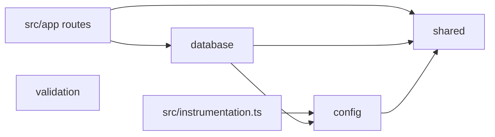

# GHOST WIRE — Stage 0 + PR 01 Foundation: Architecture

**Date:** 2026-11-12
**Status:** Architecture phase draft, for Conductor reconciliation
**Spec (source of truth for scope):** [2026-11-12-discovery-foundation-design.md](2026-11-12-discovery-foundation-design.md)
**Author role:** Backend Architect

This document fixes the *how* for the approved spec: exact dependency pins, every file to create or modify, the public interface of every module, the test harness mechanics, and the failure strategy. It does not change scope. Where the spec left a mechanism open, the decision is recorded here and marked **[decision]**. Where this document refines a spec statement, it is marked **[clarification]**. Items needing the user's call are collected in §10.

---

## 1. Dependency manifest

### 1.1 Version policy

- **Exact pins** for every direct dependency (no `^`/`~`), enforced by `bunfig.toml` `[install] exact = true`. `bun.lock` (text lockfile, Bun 1.4.x) is committed and installs use `bun install --frozen-lockfile`.
- **Soak rule [decision]:** pin the newest stable release that was published at least 7 days before 2026-11-12. Releases younger than that are skipped unless they are a security fix. This matters for a payments product, because of supply-chain risk. The skipped releases are listed in §9.
- Peer ranges were checked with `npm view <pkg>@<ver> peerDependencies engines` on 2026-11-12.

### 1.2 Runtime dependencies (`dependencies`)

| Package | Pin | Why / compatibility evidence |
|---|---|---|
| `next` | `16.4.5` | App Router. engines `node >=20.9.0`. Peer `react`/`react-dom` `^19.0.0`. 16.4.6 (published 2026-11-09) is skipped under the soak rule. |
| `react` | `19.3.1` | Satisfies the Next peer `^19.0.0`. |
| `react-dom` | `19.3.1` | Same version as `react`. |
| `mongodb` | `7.8.0` | Official driver. engines `node >=20.19.0`. Supports MongoDB server 4.4 and later, so the local 7.0.12 is fine. 7.9.0 was published on 2026-11-12 and is skipped. |
| `zod` | `4.6.7` | Zod 4 API: `z.strictObject`, `z.enum`, `.brand()`, `z.output`/`z.input`. |

### 1.3 Dev dependencies (`devDependencies`)

| Package | Pin | Why / compatibility evidence |
|---|---|---|
| `typescript` | `6.0.3` | **Not 7.x.** `typescript-eslint` 8.72.x (which `eslint-config-next` pulls in at `^8.56.0`) has the peer `typescript >=4.8.4 <6.1.0`. TS 7.0.2 (`latest`) breaks linting. |
| `@types/node` | `24.19.2` | Matches the Node 24 runtime. Satisfies the Vitest peer `^22 \|\| >=24`. |
| `@types/react` | `19.3.0` | |
| `@types/react-dom` | `19.3.0` | |
| `eslint` | `9.39.5` | **Not 10.x.** `eslint-config-next@16.4.5` depends on `eslint-plugin-react@7.37.5` (peer `eslint ^9.7`), `eslint-plugin-import@2.32.0` (peer `^9`) and `eslint-plugin-jsx-a11y@6.10.2` (peer `^9`). None of them accept ESLint 10. 9.39.5 is the `maintenance` dist-tag. |
| `eslint-config-next` | `16.4.5` | Must equal the `next` version. Provides the flat-config entries `eslint-config-next/core-web-vitals` and `eslint-config-next/typescript`. Peer `eslint >=9`. |
| `eslint-config-prettier` | `10.1.8` | Imported from `eslint-config-prettier/flat`. Turns off stylistic rules that conflict with Prettier. |
| `prettier` | `3.9.10` | 3.10.0 and 3.10.1 were published on 2026-11-11 and 2026-11-12 and are skipped. |
| `vitest` | `5.1.0` | engines `node ^22.12.0 \|\| ^24.0.0 \|\| >=26`. Peer `vite ^6.4 \|\| ^7 \|\| ^8`. Uses `test.projects`, `TestProject.provide` and `inject`. |
| `@vitest/coverage-v8` | `5.1.0` | Exact peer of `vitest@5.1.0`. |
| `vite` | `8.3.6` | **Must be installed explicitly**, because it is a peer of Vitest 5 and not a dependency. 8.3.7 and 8.3.8 are younger than 7 days. |
| `mongodb-memory-server-core` | `11.3.0` | **[decision]** This is the `-core` variant of the spec's `mongodb-memory-server`. It has the same API but no `postinstall` binary download. Bun blocks untrusted lifecycle scripts anyway, and downloads would be wasted when `MONGOMS_SYSTEM_BINARY` is set. See §10, item 3. |

**Not added (rejected):**

- `@vitejs/plugin-react`: there are no component tests in this PR, and its peer requires Vite 8 plus an oxc/babel peer set.
- `vite-tsconfig-paths`: an explicit Vite `resolve.alias` is used instead.
- `eslint-plugin-boundaries`: see §1.5.
- `@eslint/js` and `typescript-eslint` as direct dependencies: they arrive through `eslint-config-next`.
- `server-only`: it throws under Vitest unless the `react-server` condition is configured. It is deferred to the auth PR.
- `helius-sdk`: D5, research only.
- `dotenv`: Next loads `.env*` itself, and tests set env explicitly.

### 1.4 `package.json` (complete)

```json
{
  "name": "ghostwire",
  "version": "0.1.0",
  "private": true,
  "type": "module",
  "packageManager": "bun@1.4.4",
  "engines": { "node": ">=24.0.0 <25" },
  "scripts": {
    "dev": "next dev",
    "build": "next build",
    "start": "next start",
    "lint": "eslint . --max-warnings=0",
    "typecheck": "next typegen && tsc --noEmit",
    "test": "vitest run",
    "test:unit": "vitest run --project unit",
    "test:integration": "vitest run --project integration",
    "test:coverage": "vitest run --coverage",
    "format": "prettier --write .",
    "format:check": "prettier --check ."
  },
  "dependencies": {
    "mongodb": "7.8.0",
    "next": "16.4.5",
    "react": "19.3.1",
    "react-dom": "19.3.1",
    "zod": "4.6.7"
  },
  "devDependencies": {
    "@types/node": "24.19.2",
    "@types/react": "19.3.0",
    "@types/react-dom": "19.3.0",
    "@vitest/coverage-v8": "5.1.0",
    "eslint": "9.39.5",
    "eslint-config-next": "16.4.5",
    "eslint-config-prettier": "10.1.8",
    "mongodb-memory-server-core": "11.3.0",
    "prettier": "3.9.10",
    "typescript": "6.0.3",
    "vite": "8.3.6",
    "vitest": "5.1.0"
  }
}
```

Notes:

- **`"type": "module"` [decision].** All config files are ESM (`eslint.config.mjs`, `next.config.ts`, `vitest.config.ts`). Next 16 supports ESM packages.
- **Scripts run on Node, not Bun.** `bun run <script>` executes the `next`, `eslint`, `vitest` and `tsc` bins through their `#!/usr/bin/env node` shebangs. Never add `--bun`. Never type `bun test`: it invokes Bun's built-in runner and bypasses Vitest. The README must say this.
- `next lint` no longer exists in Next 16 (verified in the CLI command list), so `lint` calls ESLint directly. `next build` no longer lints. It still type-checks.
- `next typegen` (present in the 16.4 CLI) generates `next-env.d.ts` and `.next/types` route types, so `tsc` passes on a fresh clone before any build.

### 1.5 Boundary enforcement: built-in ESLint rules **[decision]**

The mechanism is built-in `no-restricted-imports` (with `patterns[].regex`, which is supported in ESLint 9.39, as confirmed in the rule source), `no-restricted-properties` and `no-restricted-syntax`, applied per file scope. `eslint-plugin-boundaries` was rejected for these reasons:

- All four spec rules can be expressed as import-specifier regexes or AST selectors.
- The plugin adds a resolver dependency (`eslint-import-resolver-typescript`) and settings that are easy to misconfigure.
- Its ESLint 9/10 peer support lags behind core.

The cost is one flat-config pitfall. **A later config object that sets the same rule replaces it rather than merging.** Every scope therefore receives a single, composed rule entry built by a helper, and scopes use disjoint `files` and `ignores` globs. See §4.

### 1.6 Node pin

- `.nvmrc` contains `24`.
- `engines.node` is `>=24.0.0 <25`.
- The local toolchain is Node v24.0.2, Bun 1.4.4 and `mongod` v7.0.12. Recommendation (not blocking): move the local Node to the current 24.x LTS patch. 24.0.x predates the 24 LTS line.

---

## 2. Directory tree (every file created or modified)

`C` = create, `M` = modify.

```text
.
├── .env.example                         C
├── .gitignore                           M  (append, keep existing .agenkit lines)
├── .nvmrc                               C
├── .prettierignore                      C
├── .prettierrc                          C
├── README.md                            M  (add "Development setup" section)
├── bun.lock                             C  (generated by bun install; committed)
├── bunfig.toml                          C
├── eslint.config.mjs                    C
├── next.config.ts                       C
├── package.json                         C
├── tsconfig.json                        C
├── vitest.config.ts                     C
├── docs/
│   ├── OPEN_DECISIONS.md                M  (§3 ticks + ADR links)
│   └── adr/
│       ├── 0001-single-app-module-boundaries.md   C
│       ├── 0002-bun-tooling-node-runtime.md       C
│       ├── 0003-mongodb-driver-zod.md             C
│       ├── 0004-vitest-memory-replset.md          C
│       └── 0005-helius-sdk-discovery.md           C
├── src/
│   ├── instrumentation.ts               C  (fail-fast config at server boot)
│   ├── app/
│   │   ├── layout.tsx                   C
│   │   ├── page.tsx                     C
│   │   └── api/
│   │       ├── health/route.ts          C
│   │       └── ready/route.ts           C
│   └── modules/
│       ├── shared/
│       │   ├── index.ts                 C
│       │   └── internal/
│       │       ├── errors.ts            C
│       │       ├── result.ts            C
│       │       ├── logger.ts            C
│       │       ├── redact.ts            C
│       │       └── http.ts              C  (toErrorResponse, noStoreJson)
│       ├── validation/
│       │   ├── index.ts                 C
│       │   └── internal/
│       │       ├── base-units.ts        C
│       │       └── ids.ts               C
│       ├── config/
│       │   ├── index.ts                 C
│       │   └── internal/
│       │       ├── schema.ts            C
│       │       └── load.ts              C
│       ├── database/
│       │   ├── index.ts                 C
│       │   └── internal/
│       │       ├── client.ts            C  (cached MongoClient, getDb, closeDb)
│       │       ├── ping.ts              C
│       │       ├── transaction.ts       C
│       │       ├── indexes.ts           C
│       │       ├── typed-collection.ts  C
│       │       └── errors.ts            C  (mapMongoError, hasErrorLabelDeep)
│       ├── privacy/index.ts             C  export {};
│       ├── wallet/index.ts              C  export {};
│       ├── payments/index.ts            C  export {};
│       ├── blockchain/index.ts          C  export {};
│       └── security/index.ts            C  export {};
└── tests/
    ├── setup/
    │   ├── integration.global.ts        C  (globalSetup: MongoMemoryReplSet, provide)
    │   └── integration.setup.ts         C  (setupFiles: env + per-file DB + closeDb)
    ├── helpers/
    │   └── mongo.ts                     C  (useDatabaseUri, startStandalone)
    ├── unit/
    │   ├── config/load-config.test.ts   C
    │   ├── validation/base-units.test.ts C
    │   ├── validation/object-id.test.ts C
    │   ├── shared/errors.test.ts        C  (AppError subclasses + toErrorResponse)
    │   ├── shared/result.test.ts        C
    │   ├── shared/logger.test.ts        C  (level filter + redaction)
    │   └── lint/boundaries.test.ts      C
    ├── integration/
    │   ├── database/ping.test.ts        C
    │   ├── database/transaction.test.ts C
    │   ├── database/indexes.test.ts     C
    │   ├── database/typed-collection.test.ts C
    │   ├── routes/health.test.ts        C
    │   └── routes/ready.test.ts         C
    └── fixtures/lint/
        ├── deep-import.ts               C
        ├── relative-escape.ts           C
        ├── module-imports-app.ts        C
        ├── mongodb-outside-database.ts  C
        ├── env-outside-config.ts        C
        ├── nested-internal.ts           C
        ├── allowed-database.ts          C
        └── allowed-config.ts            C
```

Structural rules (enforced in §4):

- A module contains only `index.ts` and a **flat** `internal/` directory.
- Within a module, files use relative imports. Across modules, files use `@/modules/<name>` only.

### 2.1 Config file contents (decisions that matter)

**`tsconfig.json`**

```json
{
  "compilerOptions": {
    "target": "ES2022",
    "lib": ["dom", "dom.iterable", "es2023"],
    "module": "esnext",
    "moduleResolution": "bundler",
    "jsx": "react-jsx",
    "strict": true,
    "noUncheckedIndexedAccess": true,
    "noImplicitOverride": true,
    "noFallthroughCasesInSwitch": true,
    "isolatedModules": true,
    "esModuleInterop": true,
    "resolveJsonModule": true,
    "skipLibCheck": true,
    "allowJs": false,
    "noEmit": true,
    "incremental": true,
    "types": ["node"],
    "paths": { "@/*": ["./src/*"] },
    "plugins": [{ "name": "next" }]
  },
  "include": ["next-env.d.ts", "src/**/*.ts", "src/**/*.tsx", "tests/**/*.ts", "*.ts",
              ".next/types/**/*.ts", ".next/dev/types/**/*.ts"],
  "exclude": ["node_modules", ".next/cache", "tests/fixtures/**"]
}
```

- `target` must be **at least ES2020**, because `baseUnits` and its tests use `bigint` literals (`5n`). Next's scaffold default of ES2017 fails to compile them.
- TS 6 changed two defaults: `types` now defaults to `[]`, and `baseUrl` is deprecated. Hence `"types": ["node"]` and `paths` without `baseUrl`.
- The include list matches what Next 16 writes, so `next build` does not rewrite the file.

**`next.config.ts`**: `{ reactStrictMode: true, poweredByHeader: false }`. `mongodb` is already in Next's default server-external list, so it needs no entry. Do not enable `cacheComponents`, because it is incompatible with the spec-mandated `export const dynamic = "force-dynamic"`.

**`bunfig.toml`**

```toml
[install]
exact = true
```

**`.prettierrc`**: `{ "printWidth": 100, "trailingComma": "all", "singleQuote": false, "semi": true }`.

**`.prettierignore`**: `.next/`, `node_modules/`, `coverage/`, `bun.lock`, `next-env.d.ts`, `docs/`, `AGENTS.md`, `.agenkit/`, `.claude/`. Existing docs are not reformatted in this PR.

**`.gitignore` additions**: `node_modules/`, `.next/`, `out/`, `coverage/`, `next-env.d.ts`, `*.tsbuildinfo`, `.env`, `.env.*`, `!.env.example`, `*.log`, `.DS_Store`.

**`.env.example`** (no secrets, no credentials):

```dotenv
# MongoDB connection string. Local dev needs a replica set for transactions:
#   mongod --replSet rs0 --dbpath ./.data/db  then  mongosh --eval "rs.initiate()"
MONGODB_URI=mongodb://127.0.0.1:27017/?replicaSet=rs0
MONGODB_DB_NAME=ghostwire_dev
# debug | info | warn | error (default: info)
LOG_LEVEL=info
# NODE_ENV is set by Next.js and Vitest; do not set it here.
# Tests only (optional): use a local mongod instead of downloading one.
# MONGOMS_SYSTEM_BINARY=/usr/bin/mongod
```

If the planner keeps `.data/` in the README instructions, add it to `.gitignore`.

**`vitest.config.ts`**

```ts
import { fileURLToPath } from "node:url";
import { defineConfig } from "vitest/config";

export default defineConfig({
  resolve: { alias: { "@": fileURLToPath(new URL("./src", import.meta.url)) } },
  test: {
    environment: "node",
    restoreMocks: true,
    coverage: {
      provider: "v8",
      include: ["src/**/*.{ts,tsx}"],
      exclude: ["src/app/layout.tsx", "src/app/page.tsx", "src/modules/*/index.ts"],
      reporter: ["text", "html", "lcov"],
      reportsDirectory: "coverage",
    },
    projects: [
      { extends: true, test: { name: "unit", include: ["tests/unit/**/*.test.ts"], testTimeout: 10_000 } },
      {
        extends: true,
        test: {
          name: "integration",
          include: ["tests/integration/**/*.test.ts"],
          globalSetup: ["tests/setup/integration.global.ts"],
          setupFiles: ["tests/setup/integration.setup.ts"],
          pool: "forks",
          testTimeout: 30_000,
          hookTimeout: 120_000,
        },
      },
    ],
  },
});
```

The coverage config sets no threshold, which matches the spec's out-of-scope list.

---

## 3. Module interfaces (public `index.ts` exports)

### 3.0 Module dependency direction (convention, reviewed in code review)



- `shared` and `validation` import no other module.
- `config` imports only `shared`.
- `database` imports `config` and `shared`.

The modules must stay acyclic. The direction is not lint-enforced in this PR, because the spec lists four rules. It is a candidate R5 for a later PR.

### 3.1 `@/modules/shared`

```ts
// ---- errors ----
export interface AppErrorInit {
  readonly code: string;
  readonly httpStatus: number;
  readonly safeMessage: string;
  readonly message?: string;        // internal, may be detailed, never sent to clients
  readonly cause?: unknown;         // passed to native Error cause (ES2022)
}
export class AppError extends Error {
  readonly code: string;
  readonly httpStatus: number;
  readonly safeMessage: string;
  constructor(init: AppErrorInit);  // name = new.target.name; message = init.message ?? init.safeMessage
}
export interface AppErrorOptions {
  readonly code?: string;
  readonly safeMessage?: string;
  readonly message?: string;
  readonly cause?: unknown;
}
export class ValidationError extends AppError { constructor(options?: AppErrorOptions) }
export class NotFoundError extends AppError { constructor(options?: AppErrorOptions) }
export class ConflictError extends AppError { constructor(options?: AppErrorOptions) }
export type DependencyName = "database";
export class DependencyUnavailableError extends AppError {
  readonly dependency: DependencyName;
  constructor(dependency: DependencyName, options?: AppErrorOptions);
}
export class InternalError extends AppError { constructor(options?: AppErrorOptions) }
export interface ConfigIssue { readonly key: string; readonly reason: string }
export class ConfigError extends AppError {
  readonly issues: readonly ConfigIssue[];
  constructor(issues: readonly ConfigIssue[]);
  // message: "Invalid configuration: MONGODB_URI (Required); LOG_LEVEL (Invalid option: expected one of debug|info|warn|error)"
}
export function isAppError(value: unknown): value is AppError;

// ---- result ----
export type Result<T, E = AppError> =
  | { readonly ok: true; readonly value: T }
  | { readonly ok: false; readonly error: E };
export function ok<T>(value: T): Result<T, never>;
export function err<E>(error: E): Result<never, E>;
export function isOk<T, E>(result: Result<T, E>): result is { readonly ok: true; readonly value: T };

// ---- logger ----
export const LOG_LEVELS: readonly ["debug", "info", "warn", "error"];
export type LogLevel = (typeof LOG_LEVELS)[number];
export type LogFields = Readonly<Record<string, unknown>>;
export interface Logger {
  debug(msg: string, fields?: LogFields): void;
  info(msg: string, fields?: LogFields): void;
  warn(msg: string, fields?: LogFields): void;
  error(msg: string, fields?: LogFields): void;
}
export interface LogSink { write(level: LogLevel, line: string): void }
export interface CreateLoggerOptions {
  readonly level: LogLevel | (() => LogLevel);
  readonly sink?: LogSink;          // default: debug/info -> process.stdout, warn/error -> process.stderr
  readonly now?: () => Date;        // default: () => new Date()
}
export function createLogger(options: CreateLoggerOptions): Logger;
export const logger: Logger;                       // singleton, level from setLogLevel (initially "info")
export function setLogLevel(level: LogLevel): void;
export const REDACTED: "[REDACTED]";
export function redact(value: unknown): unknown;   // pure; exported for unit tests

// ---- http ----
export function noStoreJson(body: unknown, init?: { status?: number; headers?: Record<string, string> }): Response;
export function toErrorResponse(error: unknown): Response;
```

**Error defaults table**

| Class | `code` | `httpStatus` | `safeMessage` |
|---|---|---|---|
| `ValidationError` | `VALIDATION_FAILED` | 400 | `Invalid request` |
| `NotFoundError` | `NOT_FOUND` | 404 | `Not found` |
| `ConflictError` | `CONFLICT` | 409 | `Conflict` |
| `DependencyUnavailableError` | `DEPENDENCY_UNAVAILABLE` | 503 | `Service temporarily unavailable` |
| `InternalError` | `INTERNAL` | 500 | `Internal error` |
| `ConfigError` | `CONFIG_INVALID` | 500 | `Internal error` |

**`toErrorResponse(error)`**

- It always calls `logger.error("request failed", { err: error })`, as the spec requires.
- If `isAppError(error)`, it returns `noStoreJson({ code, message: safeMessage }, { status: httpStatus })`. A `DependencyUnavailableError` additionally gets the header `Retry-After: 5`.
- Otherwise it returns `noStoreJson({ code: "INTERNAL", message: "Internal error" }, { status: 500 })`.
- The response never contains `error.message`, `stack` or `cause`.
- `noStoreJson` always sets `Cache-Control: no-store` and `Content-Type: application/json`.

**Logger line format** is one JSON object per line: `{"ts":"<ISO-8601>","level":"info","msg":"<msg>"}` merged with the redacted `fields`.

- Reserved keys (`ts`, `level`, `msg`) win over same-named fields.
- Lines below the current level are dropped before serialization.
- The logger never throws. If serialization fails, it writes `{"ts","level","msg","logError":"serialization_failed"}`.

**Redaction rules (`redact`)**

| Rule | Behaviour |
|---|---|
| Key match | Recursive. Each key is lowercased and checked for a substring among `key`, `seed`, `secret`, `token`, `password`, `mnemonic`, `viewingkey`, `privatekey`, `signature`, `authorization`, `cookie`. A match replaces the value with `"[REDACTED]"`, whatever its type (objects included). |
| Containers | Arrays are mapped element-wise. Plain objects, `Map` (converted to an object) and `Set` (converted to an array) are walked. |
| `Error` instances | Become `{ name, message, code?, errorLabels?, stack, cause }`, with `cause` recursed. `stack` stays in logs, which are server-side only. |
| `bigint` | Becomes its decimal string. |
| Cycles | Become `"[Circular]"`, tracked with a `WeakSet`. |
| Depth | Values deeper than 8 levels become `"[Truncated]"`. |
| String values **[clarification, additive]** | Any `scheme://user:pass@` credential segment is replaced with `scheme://[REDACTED]@`, using the regex `/([a-z][a-z0-9+.-]*:\/\/)[^\s/@]+@/gi`. This also applies to `msg`. Driver error messages can embed connection strings, so this is defence in depth on top of the spec's key-based rules. |

### 3.2 `@/modules/validation`

```ts
import type { z } from "zod";
export const baseUnits: z.ZodType<bigint, bigint | string>;
// = z.union([z.bigint().nonnegative(), z.string().regex(/^(0|[1-9][0-9]*)$/).transform(BigInt)])
export type BaseUnits = bigint;

export const objectIdString: z.ZodType<ObjectIdString, string>;
// = z.string().regex(/^[0-9a-fA-F]{24}$/).transform(s => s.toLowerCase()).brand<"ObjectIdString">()
export type ObjectIdString = string & z.BRAND<"ObjectIdString">;
export function isObjectIdString(value: unknown): value is ObjectIdString; // lowercase 24-hex only
```

- `baseUnits` has no upper bound in this PR. The spec's test accepts 2^64. Asset-specific bounds (u64 for SPL amounts) belong to the payments PR.
- `baseUnits` rejects the JS `number` type, because `z.bigint()` does not coerce.
- The custom error messages contain no input values.

### 3.3 `@/modules/config`

```ts
import type { LogLevel } from "@/modules/shared";
export type NodeEnv = "development" | "test" | "production";
export interface AppConfig {
  readonly NODE_ENV: NodeEnv;
  readonly MONGODB_URI: string;
  readonly MONGODB_DB_NAME: string;
  readonly LOG_LEVEL: LogLevel;
}
export type EnvSource = Readonly<Record<string, string | undefined>>;
/** @throws ConfigError (from @/modules/shared) */
export function loadConfig(env?: EnvSource): AppConfig;
export function resetConfigForTests(): void;
```

**Schema** (`internal/schema.ts`; every reason string is static and contains no value):

| Key | Rule | Reason on failure |
|---|---|---|
| `NODE_ENV` | `z.enum(["development","test","production"])`, required | `Required` / `Invalid option: expected one of development\|test\|production` |
| `MONGODB_URI` | string matching `/^mongodb(\+srv)?:\/\/\S+$/` **[clarification]** | `Required` / `Must be a mongodb:// or mongodb+srv:// connection string` |
| `MONGODB_DB_NAME` | string matching `/^[A-Za-z0-9_-]{1,63}$/` **[clarification]** | `Required` / `Must be 1-63 chars of A-Z a-z 0-9 _ -` |
| `LOG_LEVEL` | `z.enum(LOG_LEVELS).default("info")` | `Invalid option: expected one of debug\|info\|warn\|error` |

- Empty strings are treated as missing (`z.preprocess(v => v === "" ? undefined : v, …)`).
- Unknown env keys are ignored. The schema picks only these four.
- `MONGODB_URI` does not use `z.url()`. WHATWG `URL` rejects valid multi-host seed lists such as `mongodb://h1,h2/?replicaSet=x`. The driver performs the full parse at connect time.
- The database-name regex is stricter than "non-empty", because MongoDB forbids `/\. "$*<>:|?` in database names.

**Memoization semantics [decision]:**

- `loadConfig()` (no argument) parses `process.env` once, caches a frozen `AppConfig`, and calls `setLogLevel(config.LOG_LEVEL)`. Later no-argument calls return the cached object.
- `loadConfig(env)` (explicit argument) is **pure**. It parses `env`, returns a fresh frozen object, and neither reads nor writes the cache nor touches the logger level. Unit tests use this form, so they never depend on call order.
- `resetConfigForTests()` clears the cache only.
- The `MongoClient` is bound to the config that was current when the client was created. To point the database at a new URI, a test does: set env → `resetConfigForTests()` → `await closeDb()`. The helper `useDatabaseUri` in §6.3 does exactly this.
- `ConfigError.message` lists each failing key and its reason, in schema key order. It never includes a value. Zod 4 issues do not carry input unless `reportInput` is set, and the module builds its own reasons regardless.

### 3.4 `@/modules/database`

```ts
import type { z } from "zod";
import type { ClientSession, Db, Filter, Sort, WithId } from "mongodb";
export type { ClientSession, Db, Filter, Sort, WithId, ObjectId } from "mongodb"; // type-only re-exports

/** @throws DependencyUnavailableError (connect failed/timed out), ConfigError (invalid config) */
export function getDb(): Promise<Db>;
/** @throws DependencyUnavailableError on any failure or when timeoutMs elapses; RangeError if timeoutMs ∉ [1, 30000] */
export function ping(timeoutMs?: number): Promise<void>;                 // default 2000

export interface WithTransactionOptions { readonly maxAttempts?: number } // default 3, integer in [1, 10]
/** @throws whatever fn throws (non-retryable, unchanged); DependencyUnavailableError when retries are exhausted */
export function withTransaction<T>(
  fn: (session: ClientSession) => Promise<T>,
  options?: WithTransactionOptions,
): Promise<T>;

export type IndexDirection = 1 | -1;
export interface IndexSpec {
  readonly name: string;                                       // /^[A-Za-z0-9_]{1,64}$/, unique per collection
  readonly key: Readonly<Record<string, IndexDirection>>;      // ≥1 field; insertion order = key order
  readonly unique?: boolean;
  readonly sparse?: boolean;
  readonly expireAfterSeconds?: number;                        // integer ≥ 0
  readonly partialFilterExpression?: Readonly<Record<string, unknown>>;
}
/** @throws InternalError("INDEX_REGISTRY_CONFLICT") if a name is re-registered with a different spec, or the collection/index name is invalid */
export function registerIndexes(collection: string, specs: readonly IndexSpec[]): void;
/** @throws InternalError("INDEX_CONFLICT") on server codes 85/86; DependencyUnavailableError on connectivity */
export function ensureIndexes(): Promise<void>;
export function resetIndexRegistryForTests(): void;

export interface TypedCollection<S extends z.ZodObject> {
  readonly name: string;
  /** @throws ValidationError("DOCUMENT_INVALID"), ConflictError("DUPLICATE_KEY"), DependencyUnavailableError */
  insertOne(doc: z.input<S>, options?: { session?: ClientSession }): Promise<WithId<z.output<S>>>;
  /** @throws InternalError("DATA_INTEGRITY") if a stored doc fails the schema; DependencyUnavailableError */
  findOne(filter: Filter<z.output<S>>, options?: { session?: ClientSession }): Promise<WithId<z.output<S>> | null>;
  /** limit is required, integer in [1, 1000] (no unbounded reads). Same throws as findOne. */
  find(filter: Filter<z.output<S>>, options: { limit: number; sort?: Sort; session?: ClientSession }): Promise<WithId<z.output<S>>[]>;
}
/** Sync; no I/O. Collection name must match /^[a-z][a-z0-9_]{0,62}$/ (snake_case per DATA_MODEL.md) else InternalError. */
export function typedCollection<S extends z.ZodObject>(name: string, schema: S): TypedCollection<S>;

export function closeDb(): Promise<void>;   // idempotent; never throws (close errors logged at warn)
```

**Mechanics**

- **Client (`internal/client.ts`):**
  - The `MongoClient` is created lazily on the first `getDb()`, with options from §5.2. The module caches a `Promise<MongoClient>` (the result of `client.connect()`), so concurrent callers share one connect.
  - If connect rejects, the cache is cleared and the call throws `DependencyUnavailableError("database", { cause })`.
  - In `NODE_ENV=development` only, the promise is also stored on `globalThis[Symbol.for("ghostwire.mongoClient")]`, so Next dev hot reloads do not leak pools. In test and production the cache is module-level only. Vitest workers must not share a client across test files with different configs.
  - `getDb()` returns `client.db(config.MONGODB_DB_NAME)`.
- **Nothing runs at import time.** No module calls `loadConfig()` or connects at the top level. This keeps `next build` (which imports route modules to collect page data) working without a `.env` on a fresh clone.
- **`ping(timeoutMs)`:**
  - Races `getDb().then(db => db.command({ ping: 1 }))` against a `setTimeout(timeoutMs)`.
  - On timeout it throws `DependencyUnavailableError("database", { message: "ping timed out after <n>ms" })`. The losing promise gets `.catch(() => {})` to prevent an unhandled rejection, and the timer is cleared in `finally`.
  - Any other rejection becomes a `DependencyUnavailableError` with `cause`, except `ConfigError`, which propagates unchanged because misconfiguration is not a dependency outage.
  - The underlying operation stays bounded by `serverSelectionTimeoutMS` (2000).
- **`withTransaction`** is a hand-rolled loop, **not** the driver's `session.withTransaction`. The driver helper retries for up to 120 seconds without a count bound, which violates "bounded retries". The loop is specified in §5.3.
- **`typedCollection`:**
  - `insertOne` runs `schema.safeParse(doc)`. On failure it throws `ValidationError({ code: "DOCUMENT_INVALID", safeMessage: "Invalid document", message: "<collection>: <issue paths>" , cause: zodError })`. It then inserts the **parsed output**, so unknown keys are stripped (use `z.strictObject` to reject them), and returns `{ _id: insertedId, ...parsed }`.
  - Reads split `_id` off, run `schema.safeParse(rest)`, and return `{ _id, ...parsed }`. Schemas must not declare `_id`.
  - Driver errors go through `mapMongoError`.
- **`mapMongoError(err)`** (internal):

  | Driver error | Result |
  |---|---|
  | `MongoServerSelectionError`, `MongoNetworkError` (includes `MongoNetworkTimeoutError`), `MongoTopologyClosedError`, `MongoNotConnectedError` | `DependencyUnavailableError("database", { cause })` |
  | `MongoServerError` with `code === 11000` | `ConflictError({ code: "DUPLICATE_KEY", safeMessage: "Resource already exists", cause })` |
  | Anything else | Rethrown unchanged |

  The original error is always kept as `cause`, so transaction labels survive (see `hasErrorLabelDeep` in §5.3).
- **Index registry:**
  - A module-level `Map<collection, Map<indexName, IndexSpec>>`.
  - Re-registering an identical spec (deep-equal) is a no-op, so the call is safe under HMR and repeated imports.
  - `ensureIndexes()` iterates collections in insertion order and runs `db.collection(c).createIndexes(specs)` for each, with explicit `name` and options.
  - Because names are explicit, a second run is a server no-op, which makes the call idempotent.
  - **Invocation [decision]:** nothing calls `ensureIndexes()` in this PR except tests. No collections register indexes yet. The call site (a `bun run db:indexes` script or boot hook) is chosen in the first PR that adds a collection. See §10, item 4.

### 3.5 Placeholder modules

`privacy`, `wallet`, `payments`, `blockchain` and `security` each have an `index.ts` containing exactly `export {};`. Each has no `internal/` directory.

### 3.6 Routes and instrumentation

```ts
// src/app/api/health/route.ts
export const runtime = "nodejs";
export const dynamic = "force-dynamic";
export function GET(_request: Request): Response;          // noStoreJson({ status: "ok" }, { status: 200 })

// src/app/api/ready/route.ts
export const runtime = "nodejs";
export const dynamic = "force-dynamic";
export async function GET(_request: Request): Promise<Response>;
// try { await ping(); return noStoreJson({status:"ready",checks:{database:"up"}}, {status:200}) }
// catch (error) { logger.warn("readiness check failed", { err: error });
//                 return noStoreJson({status:"unavailable",checks:{database:"down"}}, {status:503}) }

// src/instrumentation.ts  [decision: fail-fast at boot]
export async function register(): Promise<void>;
// if (process.env.NEXT_RUNTIME !== "nodejs") return;
// if (process.env.NEXT_PHASE === "phase-production-build") return;
// const { loadConfig } = await import("@/modules/config"); loadConfig();  // throws ConfigError → server fails to start
```

- `/api/ready` catches **every** error, including `ConfigError`, and returns the fixed 503 body. Readiness is "not ready" whatever the reason.
- `/api/health` imports nothing from `database` or `config`, and it cannot fail on dependencies.
- `layout.tsx` and `page.tsx` are static placeholders with the title "GHOST WIRE". **No `next/font/google`**: it fetches over the network at build time and would break offline or reproducible builds.

---

## 4. Boundary enforcement design (`eslint.config.mjs`)

**Composition**

```js
import { defineConfig, globalIgnores } from "eslint/config";
import nextVitals from "eslint-config-next/core-web-vitals";
import nextTs from "eslint-config-next/typescript";
import prettier from "eslint-config-prettier/flat";
// … boundary helper + scope objects (below) …
export default defineConfig([
  globalIgnores([".next/**", "node_modules/**", "coverage/**", "next-env.d.ts",
                 "tests/fixtures/**", ".agenkit/**", ".claude/**"]),
  ...nextVitals, ...nextTs,
  ...boundaryScopes,           // generated, disjoint files/ignores
  prettier,
]);
```

**Restriction atoms**

| Atom | Rule | Matcher | Message |
|---|---|---|---|
| R1 deep | `no-restricted-imports` pattern | regex `^@/modules/[^/]+/.+` | Import modules only via their public entry '@/modules/<name>'. |
| R1 rel-into-modules | `no-restricted-imports` pattern | regex `^\.{1,2}/(.+/)?modules/` | Use '@/modules/<name>', not relative paths into src/modules. |
| R1 escape (depth 1) | `no-restricted-imports` pattern | regex `^\.\./` | Relative imports must stay inside the module; use '@/modules/<name>'. |
| R1 escape (depth 2) | `no-restricted-imports` pattern | regex `^\.\./\.\./` | Same as above. |
| R1 flat internal | `no-restricted-syntax` | selector `Program` | internal/ must be flat; no subdirectories. |
| R2 app | `no-restricted-imports` pattern | regex `^@/app(/\|$)` | src/modules/** must not import from src/app/**. |
| R3 mongodb | `no-restricted-imports` pattern + `no-restricted-syntax` | regex `^(mongodb\|bson)(/\|$)`; selector `ImportExpression[source.value=/^(mongodb\|bson)(\/\|$)/]` | Only src/modules/database/** may import 'mongodb'. |
| R4 env | `no-restricted-properties`, `no-restricted-imports` paths, `no-restricted-syntax` | `{object:"process",property:"env"}`; paths `process` and `node:process` with `importNames:["env"]`; selectors `VariableDeclarator[init.name='process'] > ObjectPattern > Property[key.name='env']` and `MemberExpression[object.property.name='process'][property.name='env']` (catches `globalThis.process.env`) | Only src/modules/config/** may read process.env. |

`no-restricted-imports` also flags `import type` and `export … from`, so type-only `mongodb` imports outside `database` are banned too. Types come through the `database` index re-exports.

**Scopes.** A helper `scope(files, ignores, atoms)` emits one config object containing exactly one `no-restricted-imports`, one `no-restricted-syntax` and one `no-restricted-properties` entry, built by concatenating the atoms.

| # | `files` | `ignores` | Atoms |
|---|---|---|---|
| S1 | `src/app/**/*.{ts,tsx}`, `src/*.{ts,tsx}` | `src/instrumentation.ts` | R1 deep, R1 rel-into-modules, R3, R4 |
| S2 | `src/instrumentation.ts` | none | R1 deep, R1 rel-into-modules, R3 (env allowed: Next runtime file) |
| S3 | `src/modules/database/*.ts` | none | R1 deep, R1 escape-1, R2, R4 |
| S4 | `src/modules/database/internal/*.ts` | none | R1 deep, R1 escape-2, R2, R4 |
| S5 | `src/modules/config/*.ts` | none | R1 deep, R1 escape-1, R2, R3 |
| S6 | `src/modules/config/internal/*.ts` | none | R1 deep, R1 escape-2, R2, R3 |
| S7 | `src/modules/*/*.{ts,tsx}` | `src/modules/{database,config}/**` | R1 deep, R1 escape-1, R2, R3, R4 |
| S8 | `src/modules/*/internal/*.{ts,tsx}` | `src/modules/{database,config}/**` | R1 deep, R1 escape-2, R2, R3, R4 |
| S9 | `src/modules/*/internal/*/**/*.{ts,tsx}` | none | R1 flat internal |
| S10 | `tests/unit/**/*.ts` | none | R1 deep, R1 rel-into-modules, R3, R4 |
| S11 | `tests/integration/**/*.ts` | none | R1 deep, R1 rel-into-modules, R4. Integration tests may import `mongodb` to build labelled `MongoError`s and to spy on `ClientSession`. |
| S12 | `tests/setup/**/*.ts`, `tests/helpers/**/*.ts` | none | R1 deep, R1 rel-into-modules (env allowed: test setup) |

Root config files (`*.config.ts`, `eslint.config.mjs`) have no boundary atoms. They are the spec's "Next/tooling config files" exception.

**Fixture test (`tests/unit/lint/boundaries.test.ts`)**

- It creates `new ESLint({ cwd: repoRoot, overrideConfigFile: path.join(repoRoot, "eslint.config.mjs") })`.
  - `repoRoot` is `fileURLToPath(new URL("../../../", import.meta.url))`.
  - With `overrideConfigFile`, ESLint 9 uses `cwd` as the base path, as verified in `lib/eslint/eslint.js`.
- For each fixture it reads `tests/fixtures/lint/<file>` and calls `eslint.lintText(code, { filePath: path.join(repoRoot, <virtualPath>) })`. The fixtures are linted **as if** they lived at in-scope paths.
- Because `tests/fixtures/**` is globally ignored and excluded from `tsconfig`, fixtures never break `bun run lint` or `typecheck`. A virtual `filePath` under `src/` is not ignored.
- Assertions filter messages to `ruleId ∈ {no-restricted-imports, no-restricted-syntax, no-restricted-properties}`. Unrelated rules such as unused variables are ignored. The test checks those messages exactly.
- The test timeout is 60 s, because the first ESLint load is cold.

| Fixture | Virtual path | Expected boundary messages |
|---|---|---|
| `deep-import.ts` (`import { x } from "@/modules/database/internal/client"`) | `src/app/__lint__/deep-import.ts` | 1 × `no-restricted-imports` (R1 deep) |
| `relative-escape.ts` (`import { y } from "../../database/internal/client"`) | `src/modules/wallet/internal/__lint__.ts` | 1 × `no-restricted-imports` (R1 escape) |
| `module-imports-app.ts` (`import Page from "@/app/page"`) | `src/modules/shared/internal/__lint__.ts` | 1 × `no-restricted-imports` (R2) |
| `mongodb-outside-database.ts` (static `import { MongoClient } from "mongodb"` + `await import("mongodb")`) | `src/modules/payments/internal/__lint__.ts` | 1 × `no-restricted-imports` + 1 × `no-restricted-syntax` (R3) |
| `env-outside-config.ts` (`process.env.X`, `const { env } = process`) | `src/modules/wallet/internal/__lint__.ts` | 1 × `no-restricted-properties` + 1 × `no-restricted-syntax` (R4) |
| `nested-internal.ts` (any statement) | `src/modules/wallet/internal/sub/__lint__.ts` | 1 × `no-restricted-syntax` (R1 flat) |
| `allowed-database.ts` (`import { MongoClient } from "mongodb"; import { loadConfig } from "@/modules/config"`) | `src/modules/database/internal/__lint__.ts` | 0 |
| `allowed-config.ts` (`export const u = process.env.MONGODB_URI`) | `src/modules/config/internal/__lint__.ts` | 0 |

---

## 5. Failure strategy

### 5.1 Error-handling contract per boundary

| Boundary | Inbound failures | What crosses the boundary |
|---|---|---|
| env → `config` | Missing or invalid keys | `ConfigError` with key names and reasons, never values. Thrown at boot (`instrumentation.register`) or on first lazy `loadConfig()`. |
| `database` → MongoDB | Server selection, network, timeout, duplicate key, schema mismatch | `DependencyUnavailableError`, `ConflictError("DUPLICATE_KEY")`, `ValidationError("DOCUMENT_INVALID")` or `InternalError("DATA_INTEGRITY")`. Anything else passes through raw, with the driver error kept as `cause` in every mapped case. |
| module → route | Any thrown value | Route handlers either catch and convert with `toErrorResponse` (the default for future routes), or own a fixed response (`/api/ready`). |
| route → client | n/a | `{ code, message }` with a stable `code` and a `safeMessage`, and `Cache-Control: no-store`. Never a stack trace, `cause` or driver message. |
| any → logs | n/a | Everything is logged through `logger`, so redaction always applies. `console.*` is not used in `src/`. Add `no-console: ["error"]` in `src/**` as part of S1–S8. |

### 5.2 Timeouts (every external call)

| Call | Bound | Where it is set |
|---|---|---|
| Server selection (every operation and `connect()`) | `serverSelectionTimeoutMS: 2000` | MongoClient options |
| TCP/TLS connect | `connectTimeoutMS: 2000` | MongoClient options |
| Socket inactivity | `socketTimeoutMS: 30000` | MongoClient options. No unbounded reads. |
| Pool | `maxPoolSize: 10`, `minPoolSize: 0`, `maxIdleTimeMS: 60000` | MongoClient options |
| Identity | `appName: "ghostwire"` | MongoClient options |
| Driver retries | `retryWrites: true`, `retryReads: true` (driver default: one retry on retryable errors) | MongoClient options |
| `ping()` | 2000 ms default, enforced by a timer race | `database/internal/ping.ts` |
| `/api/ready` | ≤ 2000 ms, through `ping()` | route |
| Transaction | Server `transactionLifetimeLimitSeconds` (60 s) per attempt, and at most `maxAttempts` attempts | §5.3 |
| `closeDb()` | `client.close()`. Errors are logged at warn and swallowed. | client.ts |

### 5.3 Retries and idempotency

**`withTransaction` loop (`internal/transaction.ts`)**

```text
session = client.startSession()
try:
  for attempt in 1..maxAttempts:
    session.startTransaction({ readConcern: {level:"snapshot"}, writeConcern: {w:"majority"}, readPreference: "primary" })
    try:
      result = await fn(session)
    catch e:
      await abortQuietly(session)                       // abort if inTransaction(); abort errors → logger.warn
      if hasErrorLabelDeep(e, "TransientTransactionError") and attempt < maxAttempts:
        await backoff(attempt); continue
      if hasErrorLabelDeep(e, "TransientTransactionError"): throw DependencyUnavailableError("database", {cause:e})
      throw e                                           // non-retryable: unchanged, immediately
    commit loop (shares the same attempt budget):
      try await session.commitTransaction(); return result
      catch c:
        if hasErrorLabelDeep(c, "UnknownTransactionCommitResult") and attempt < maxAttempts:
          attempt++; await backoff(attempt); retry commitTransaction only   // never re-run fn
        else if hasErrorLabelDeep(c, "TransientTransactionError") and attempt < maxAttempts:
          await abortQuietly(session); await backoff(attempt); continue outer (re-run fn)
        else if labelled: throw DependencyUnavailableError("database", {cause:c})
        else: await abortQuietly(session); throw c
finally:
  await session.endSession()
```

- **Label detection:** `hasErrorLabelDeep(e, label)` walks `e`, `e.cause`, `e.cause.cause` and so on, up to depth 5. It returns true if any link is `instanceof MongoError && link.hasErrorLabel(label)`. `MongoError.hasErrorLabel` is public in driver 7.x. The walk is needed because `typedCollection` maps driver errors into `AppError`s with the driver error as `cause`.
- **Why only the commit is retried on `UnknownTransactionCommitResult`:** if the original commit actually succeeded, re-running `fn` would apply its writes twice. The commit retry is idempotent on the server for the same session and transaction number.
- **Backoff:** full jitter, `delay = random(0, min(250, 10 · 2^attempt))` ms. That is at most 20, 40 and 80 ms for attempts 1 to 3. It is short because transient transaction conflicts clear quickly.
- **Argument check:** `maxAttempts` must be an integer in [1, 10]. Otherwise the call rejects with a `RangeError` before a session is started.
- **`fn` contract (documented in the JSDoc):** `fn` may run up to `maxAttempts` times. It must perform only database operations that pass `session`, and it must have no external side effects (HTTP, chain submission, emails). This is the idempotency foundation for payments: a chain submission never goes inside a retried closure. Later payment PRs use an idempotency-key document written inside the transaction, as `DATA_MODEL.md` §5 requires. That design is out of scope here.
- **No other retry loops exist in this PR.** Driver `retryWrites`/`retryReads` give a single built-in retry. `ping` does not retry: readiness is polled by the orchestrator. `getDb` does not retry: the next call reconnects because the cache was cleared on failure.

**Idempotent operations**

- `ensureIndexes()` uses explicit names, so repeat runs are a server no-op. A changed spec under the same name throws `InternalError("INDEX_CONFLICT")`: an index migration is needed, and it is not silently replaced.
- `registerIndexes()` with an identical spec is a no-op.
- `closeDb()` and `resetConfigForTests()` are idempotent.

### 5.4 Liveness vs readiness

| Probe | Checks | Status codes | Dependency on config |
|---|---|---|---|
| `GET /api/health` (liveness) | Nothing beyond "the process serves HTTP" | Always 200 `{"status":"ok"}` | None |
| `GET /api/ready` (readiness) | `ping()` against MongoDB, ≤ 2 s | 200 `{"status":"ready","checks":{"database":"up"}}` or 503 `{"status":"unavailable","checks":{"database":"down"}}` | Yes. Invalid config gives 503 if boot validation was somehow bypassed. |

- An orchestrator should restart on liveness failure only. A database outage must not crash-loop the app.
- Invalid config prevents the server from booting at all (`instrumentation.register`). This is the intended fail-fast behaviour, and it surfaces as a crash on deploy rather than a degraded pod.

### 5.5 Fail-fast config

- `src/instrumentation.ts` calls `loadConfig()` on Node server start (`next start` and `next dev`). It skips the `phase-production-build` phase, so `bun run build` works without a `.env`.
- `loadConfig` throws `ConfigError`. Next logs it and the process exits non-zero.
- The `ConfigError` message names only keys and static reasons, so it is safe even if the startup log is shipped somewhere.

---

## 6. Test harness mechanics

### 6.1 Global setup (`tests/setup/integration.global.ts`)

```ts
import type { TestProject } from "vitest/node";
import { MongoMemoryReplSet } from "mongodb-memory-server-core";

declare module "vitest" { export interface ProvidedContext { mongoUri: string } }

export default async function setup(project: TestProject): Promise<() => Promise<void>> {
  const replSet = await MongoMemoryReplSet.create({
    binary: { version: "7.0.12" },                  // matches local /usr/bin/mongod; download fallback uses the same version
    replSet: { count: 1, storageEngine: "wiredTiger" },
  });
  project.provide("mongoUri", replSet.getUri());
  return async () => { await replSet.stop({ doCleanup: true }); };
}
```

- **System binary:** if `MONGOMS_SYSTEM_BINARY=/usr/bin/mongod` is exported, the library uses it. Its version check compares it with `7.0.12`, and a mismatch only produces a warning. Otherwise the library downloads 7.0.12 into its cache.
- **Ubuntu 20.04 note:** this host is Ubuntu 20.04. MongoDB 8.x publishes no `ubuntu2004` builds, which is one more reason to pin 7.0.12 rather than accept the library default, 8.2.6.
- The globalSetup does not read `process.env` itself. The library reads `MONGOMS_*`.

### 6.2 Per-file setup (`tests/setup/integration.setup.ts`, runs in each worker before each test file)

```ts
import { randomUUID } from "node:crypto";
import { afterAll, inject } from "vitest";
import { resetConfigForTests } from "@/modules/config";
import { closeDb, getDb } from "@/modules/database";

process.env.NODE_ENV = "test";
process.env.LOG_LEVEL = "error";
process.env.MONGODB_URI = inject("mongoUri");
process.env.MONGODB_DB_NAME = `gw_test_${randomUUID().slice(0, 8)}`;   // one DB per test file → parallel-safe
resetConfigForTests();
afterAll(async () => {
  try { await (await getDb()).dropDatabase(); } catch { /* server may be intentionally stopped */ }
  await closeDb();
  resetConfigForTests();
});
```

### 6.3 Helpers (`tests/helpers/mongo.ts`)

```ts
export async function useDatabaseUri(uri: string): Promise<void>;  // sets MONGODB_URI, resetConfigForTests(), await closeDb()
export async function startStandalone(): Promise<MongoMemoryServer>; // MongoMemoryServer.create({ binary: { version: "7.0.12" } })
```

### 6.4 Decided test mechanics

| Spec test | Mechanism |
|---|---|
| `ping` against a stopped server | Start a dedicated standalone with `startStandalone()` and point the database at it with `useDatabaseUri(s.getUri())`. Then `await ping()` resolves. Then `await s.stop({ doCleanup: true })`. Then `await expect(ping(500)).rejects.toBeInstanceOf(DependencyUnavailableError)`, and the elapsed time is asserted to be under 1500 ms. The timer race fires at 500 ms; server selection would otherwise take 2000 ms. In `afterEach`, `useDatabaseUri(inject("mongoUri"))` restores the shared replica set. The test exercises the realistic "cached client loses its server" path. |
| `withTransaction` commits / rolls back | Create the collection in `beforeAll` (no catalog changes inside the transaction). Commit: insert through `typedCollection` with `{ session }`, then assert the document is present. Rollback: insert, then `throw new Error("boom")`. Assert the call rejects with that same instance, the document is absent, and `fn` was called once. |
| Retries a transient error | On call 1, `fn` throws `e = new MongoError("simulated")` after `e.addErrorLabel("TransientTransactionError")`, and succeeds on call 2. Assert 2 calls and the result returned. Exhaustion: always throw the labelled error. Assert 3 calls and a rejection with `DependencyUnavailableError` whose `cause` is the labelled error. |
| Does not retry other errors | `fn` throws a plain `Error`, and separately an unlabelled `MongoError`. Assert 1 call each and the same instance rethrown. |
| Commit-unknown path | `vi.spyOn(ClientSession.prototype, "commitTransaction").mockImplementationOnce(async () => { const e = new MongoError("x"); e.addErrorLabel("UnknownTransactionCommitResult"); throw e; })`. Assert `fn` was called once, commit was called twice, and exactly one document exists. `restoreMocks: true` undoes the spy. |
| `ensureIndexes` idempotent | `resetIndexRegistryForTests()`, `registerIndexes("index_probe", [{ name: "by_ref_unique", key: { ref: 1 }, unique: true }])`, `await ensureIndexes()` twice. Then `db.collection("index_probe").indexes()` lists the index once. Registering the same name with a different `key` throws `InternalError`. |
| `typedCollection` rejects invalid | A `z.strictObject({ ref: z.string().min(1), amount: z.string() })` schema. `insertOne({ ref: "" , amount: "1" })` rejects with `ValidationError`, `code === "DOCUMENT_INVALID"`, and the collection count stays 0. |
| Route handlers | `import { GET } from "@/app/api/ready/route"`, then `const res = await GET(new Request("http://localhost/api/ready"))`. Assert `res.status`, `await res.json()` and `res.headers.get("cache-control") === "no-store"`. For the down case, use `useDatabaseUri(stoppedUri)`, where `stoppedUri` comes from a standalone that was started and then stopped. Health: call `GET(new Request(...))` with no database setup. |
| Unit `loadConfig` | Always the explicit `loadConfig(env)` form. For each key, build a valid base env, break one key, and assert that `ConfigError.issues` contains that key and that `error.message` does not contain the bad value (using sentinel values such as `"SENTINEL-VALUE-123"`). |
| Logger | `createLogger({ level: "debug", sink: memorySink })`. Parse each line with `JSON.parse`. Assert redaction for nested objects, arrays, `ViewingKey`, `apiKey`, `PASSWORD`, an `Authorization` header, and a credentialed URI string. Assert level filtering. |

The `@/app/...` import in integration tests is not a deep module import (R1 matches only `@/modules/...`), so it is allowed.

---

## 7. Data model

**There are no business entities in this PR.** No collections are created by application code, and no schemas are defined beyond test-local ones. The `DATA_MODEL.md` collections (`users`, `wallets`, `payment_requests`, `payments`, `receipts`, `security_events`) arrive in their own PRs, through `typedCollection` and `registerIndexes`.

The data-layer contracts defined here are:

- `IndexSpec` / `IndexDirection` and the registry semantics (§3.4).
- `TypedCollection<S>`:
  - The Zod schema is the single source of truth for a document's shape, excluding `_id`.
  - Writes store the parsed output. Reads are parsed, and schema drift is reported as `DATA_INTEGRITY`.
  - Reads are bounded, with a `limit` of at most 1000.
- **Amounts:** `baseUnits` parses to `bigint` in memory. The persistence encoding (decimal string, `Long` or `Decimal128`) is **not** chosen here. `DATA_MODEL.md` §4 says strings at persistence and JSON boundaries. The payments PR records the decision with the Data Engineer.
- **Naming:** collection names are snake_case (`/^[a-z][a-z0-9_]{0,62}$/`), matching `DATA_MODEL.md`. Index names are explicit.

---

## 8. Observability (scope for this PR)

- The structured JSON logger with redaction (§3.1) is the only signal. Every log line goes through `redact`.
- `/api/ready` logs the readiness failure cause at `warn`. `toErrorResponse` logs at `error`.
- Correlation IDs, metrics and tracing are **deferred**: hosting and monitoring are an open decision (`OPEN_DECISIONS.md` §3). The logger's `fields` parameter accepts a `requestId` later without an interface change.

---

## 9. Risks and compatibility notes found while checking versions

1. **TypeScript 7 cannot be used yet.** `typescript-eslint` caps at `<6.1.0`, so TypeScript is pinned to 6.0.3. TS 6 changed two defaults: `types` now defaults to `[]` (set `"types": ["node"]`) and `baseUrl` is deprecated (use `paths` alone).
2. **ESLint 10 cannot be used.** `eslint-config-next@16.4.x` pulls in `eslint-plugin-react`, `eslint-plugin-import` and `eslint-plugin-jsx-a11y`, whose peer ranges stop at ESLint 9. ESLint is pinned to 9.39.5 (`maintenance`).
3. **Vite is a peer of Vitest 5, not a dependency.** It must be installed explicitly, or `bun install` warns and resolution may pick an unexpected version.
4. **mongodb-memory-server defaults to MongoDB 8.2.6.** That version has no Ubuntu 20.04 build, and this host runs Ubuntu 20.04 with a system `mongod` 7.0.12. The harness pins `binary.version: "7.0.12"`. Developers on this host should export `MONGOMS_SYSTEM_BINARY=/usr/bin/mongod`. MongoDB 7.0 is the oldest supported server for integration tests. Production server version is undecided (hosting is open).
5. **`bun test` is a trap.** It runs Bun's runner, not Vitest. Always use `bun run test`.
6. **Next 16 build with no `.env`.** It works only because nothing does I/O or config work at import time, and `instrumentation.register` skips `NEXT_PHASE=phase-production-build`. A future top-level `loadConfig()` call breaks the fresh-clone acceptance step.
7. **Next may rewrite `tsconfig.json`** on first build if the include list or `jsx` differs. The §2.1 contents mirror Next 16's expectations. If `next build` still edits the file, commit the edit and note it in ADR-0002.
8. **`dynamic = "force-dynamic"` vs `cacheComponents`.** Never enable `cacheComponents` while route segment config is in use.
9. **Fresh releases skipped (soak rule):** `next`/`eslint-config-next` 16.4.6 (2026-11-09), `mongodb` 7.9.0 (2026-11-12), `vite` 8.3.7 and 8.3.8, `prettier` 3.10.x, `typescript-eslint` 8.72.2 (transitive, resolved by the lockfile). Re-check before implementation. If 16.4.6 is a security release, take it.
10. **Node 24.0.2 locally.** It satisfies every engines field (Vitest needs `^24.0.0`, `mongodb` needs `>=20.19`). Upgrading to the 24 LTS patch line is recommended.
11. **Helius (for ADR-0005):** `npm view helius-sdk` reports 3.4.1, `"type": "module"` (ESM-only) and `engines node >=20`. The ESM-only format is compatible with this ESM project. Edge versus Node support still needs to be checked against the docs. This is evidence for the ADR, not an install.
12. **`docs/TECHNICAL_ARCHITECTURE.md` lists Bun as the runtime.** D6 (Node runtime) supersedes it. ADR-0002 should note the change, and the doc should get a pointer to the ADR.

---

## 10. Decisions for the Conductor / user

1. **[Conductor default — soak pins adopted; user may override at approval] Soak-rule pins.** This document pins the newest versions that are at least 7 days old (`next` 16.4.5, `mongodb` 7.8.0, `vite` 8.3.6, `prettier` 3.9.10) instead of the absolute latest. The alternative is to take the latest and accept supply-chain freshness risk.
2. **[Resolved — required by spec §6 "Fail fast on invalid config"] `src/instrumentation.ts` for boot-time fail-fast.** It was missing from the spec's structure tree, but the spec's fail-fast requirement needs it. Without it, invalid config only fails on the first request that loads config.
3. **[Minor deviation] `mongodb-memory-server-core`** instead of `mongodb-memory-server`. It has the identical API and avoids a `postinstall` download.
4. **[Deferred] `ensureIndexes()` call site.** Nothing calls it in this PR. The first PR that adds a collection chooses between a `db:indexes` script and a boot hook.
5. **[Clarifications, no scope change]**
   - The `MONGODB_URI` check is a scheme regex, not `z.url()`.
   - `MONGODB_DB_NAME` has a charset rule.
   - Credentialed-URI scrubbing is added to the logger.
   - `loadConfig(env)` with an explicit argument is pure, not memoized.
   - `withTransaction` retries the commit alone on `UnknownTransactionCommitResult`, and throws `DependencyUnavailableError` once retries are exhausted.
   - `no-console` applies in `src/`.
