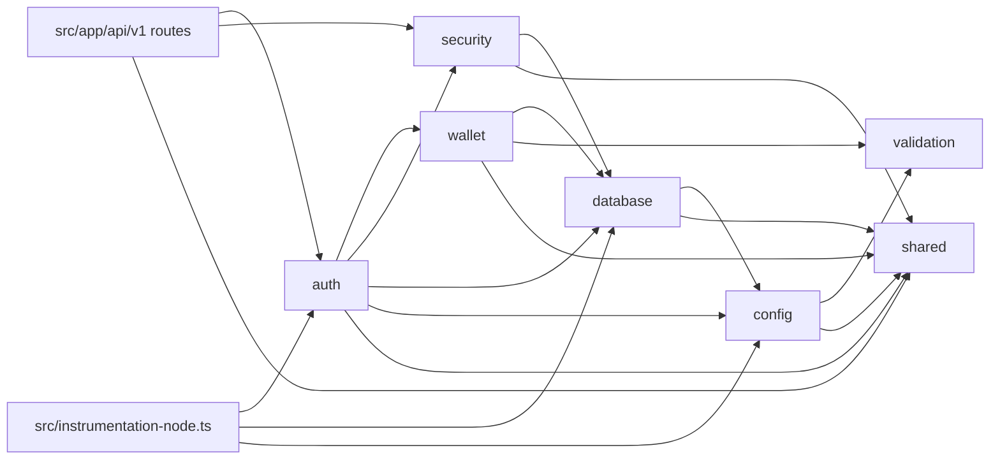

# GHOST WIRE — PR 02a Auth API: Architecture

**Date:** 2026-11-13
**Status:** Architecture phase draft, for Conductor reconciliation
**Spec (source of truth for scope):** [2026-11-13-auth-api-design.md](2026-11-13-auth-api-design.md) (decisions A1–A5 are closed and not reopened here)
**Builds on:** [2026-11-12-discovery-foundation-architecture.md](2026-11-12-discovery-foundation-architecture.md), ADRs 0001–0005
**Author role:** Backend Architect (with data-model ownership)

This document fixes the *how* for the approved spec. It covers the dependency pin, every file to create or modify, the public interface of every module and route, the data model, the failure strategy and the test harness. It does not change scope. A mechanism the spec left open is marked **[decision]**. A refinement of a spec statement is marked **[clarification]**. Items that need the user's call are collected in §7.

PR 01 conventions that this PR keeps:

- Exact pins and the 7-day soak rule (ADR-0002).
- **Nothing runs at import time.** No module calls `loadConfig()`, connects, or registers indexes at the top level. Route files only build closures at import, so `next build` on a fresh clone without a `.env` still works.
- `process.env` is read only in `config`, `src/instrumentation.ts` and the test setup/helpers.
- `mongodb`/`bson` are imported only in `database`.
- Everything is logged through `logger`, so redaction always applies.

---

## 1. Dependencies

### 1.1 New package

| Package | Pin | Section | Published | Notes |
|---|---|---|---|---|
| `bs58` | `6.0.0` | `dependencies` | 2024-06-24 | Newest stable release (no newer release exists, so the soak rule is satisfied by a wide margin). MIT. `"type": "module"` with `import`/`require` exports and bundled `.d.ts`. Unpacked size 5.1 kB. One dependency: `base-x ^5.0.0`. |
| `base-x` (transitive) | `5.0.1`, resolved by `bun.lock` | — | 2025-03-08 | No dependencies. MIT. 14.4 kB unpacked. Not a direct dependency, so it is not pinned in `package.json`. The committed lockfile pins it, as PR 01 does for transitive packages. |

Checked on 2026-11-13 with `npm view bs58 time version dependencies license type exports --json` and the same for `base-x@5.0.1`.

No other runtime or dev dependency is added. Ed25519, SHA-256, random bytes and IP parsing all come from `node:crypto` and `node:net`.

### 1.2 Base58 decoder choice **[decision: `bs58` 6.0.0]**

| Option | Assessment |
|---|---|
| **`bs58` 6.0.0 (chosen)** | This is the base58 codec the Solana JavaScript ecosystem used for years (`@solana/web3.js` 1.x depends on it). It adds two tiny packages with no further dependencies. It provides `encode`, which the test helpers need to turn generated keys and signatures into wallet-style strings. Its `decodeUnsafe` returns `undefined` instead of throwing, which fits a parser that maps every failure to one `ValidationError`. |
| `@solana/kit` address codec (`@solana/kit` 8.6.0, published 2026-10-28, passes the soak rule) | Rejected for this PR. ADR-0005 says PR 03 will likely need `@solana/kit ^8.3`, but PR 03 has to choose the exact pin together with `@heliuslabs/spr` at PR 03 start, after re-verification. Pinning kit now would decide PR 03's version early and could leave two kit versions in the tree. Kit is also a large meta-package: `@solana/addresses` alone has five `@solana/*` dependencies. That is a lot of supply chain for a 32-byte decode. |
| Hand-written decoder | Rejected. It has no supply-chain cost, but leading-zero (`1`) handling is a classic source of bugs in security-sensitive parsing. The tests would also need a hand-written encoder, which doubles the code that has to be trusted. |

**Containment.** Only `src/modules/wallet/internal/base58.ts` imports `bs58` in `src/`. The test helper `tests/helpers/ed25519.ts` may also import it, to encode. This is a convention, and it is reviewed in code review rather than linted: §2.3 explains why no new lint atom is added. When PR 03 brings in `@solana/kit`, `base58.ts` can switch to kit's codec behind the unchanged `wallet` API, and `bs58` can be removed.

**Defence in depth.** The input is checked against the base58 alphabet regex and a length range before it is decoded, so whitespace, `0`, `O`, `I` and `l` never reach the library. The decoded length is then checked exactly.

### 1.3 `node:crypto` Ed25519 on Node 24 (verified)

Verified on Node **24.0.2** (the local runtime; `engines` is `>=24.0.0 <25`) with a scratch script outside the repository:

| Check | Result |
|---|---|
| `createPublicKey({ key: concat([hex("302a300506032b6570032100"), pk32]), format: "der", type: "spki" })`, then `verify(null, message, key, sig64)` with RFC 8032 §7.1 test 1 (empty message) | `true` |
| The same signature with one bit flipped | `false` |
| A fresh `generateKeyPairSync("ed25519")` key: JWK `x` decoded from base64url equals the last 32 bytes of the SPKI DER export | equal, 32 bytes |
| Sign and verify with a fresh keypair through the raw-key SPKI wrapper | `true`, signature length 64 |
| A 10-byte signature passed to `verify` | returns `false` (does not throw) |
| A 32-byte all-`0xff` key passed to `createPublicKey` | **accepted** (Node does not validate the curve point at import) |
| Cost | about 0.28 ms per wrap-and-verify |

Consequence for `verifyEd25519`: it checks the argument lengths itself (32 and 64 bytes) and wraps both `createPublicKey` and `verify` in one `try`/`catch` that returns `false`. Then no malformed key or signature can throw out of it.

---

## 2. Directory tree (every file created or modified)

```text
package.json                                   MODIFY  + "bs58": "6.0.0" in dependencies
bun.lock                                       MODIFY  bs58 6.0.0, base-x 5.0.1
.env.example                                   MODIFY  8 new keys (§2.4)
README.md                                      MODIFY  config table rows for the 8 keys; "Auth API" section listing the endpoints
eslint.config.mjs                              MODIFY  comment only (§2.3); no scope object changes
docs/adr/0006-wallet-signature-auth.md         CREATE  A1–A5, message format, session model, mainnet-binding risk, bs58 choice, index call site
docs/DATA_MODEL.md                             MODIFY  users / wallets / security_events / sessions sections replaced by the implemented fields; add auth_challenges and rate_limits; index section lists the explicit names
docs/specs/2026-11-13-auth-api-architecture.md CREATE  this document

src/instrumentation.ts                         MODIFY  after failFastOnInvalidConfig(): await prepareDatabase()
src/instrumentation-node.ts                    MODIFY  + prepareDatabase()

src/modules/shared/index.ts                    MODIFY  + new errors, clock, noContent
src/modules/shared/internal/errors.ts          MODIFY  + UnauthenticatedError, AuthFailedError, ForbiddenOriginError, RateLimitedError
src/modules/shared/internal/http.ts            MODIFY  5xx collapsing, Retry-After for 429, bigint replacer, noContent()
src/modules/shared/internal/redact.ts          MODIFY  9 new key parts; Bearer/Basic and query-parameter scrubbing; extended residual-risk comment
src/modules/shared/internal/clock.ts           CREATE  now(), setClockForTests(), resetClockForTests()

src/modules/validation/index.ts                MODIFY  + SOLANA_NETWORK_IDS, solanaNetwork, SolanaNetwork
src/modules/validation/internal/solana.ts      CREATE

src/modules/config/index.ts                    MODIFY  (AppConfig type gains fields; exports unchanged)
src/modules/config/internal/schema.ts          MODIFY  8 keys, cross-field rule, static reasons
src/modules/config/internal/load.ts            MODIFY  AppConfig fields; freeze SOLANA_NETWORKS array

src/modules/database/index.ts                  MODIFY  + safeEquals, SafeScalar, parseObjectId, objectIdSchema, ensureIndexesOnce, TypedUpdate
src/modules/database/internal/safe-filter.ts   CREATE  safeEquals
src/modules/database/internal/ids.ts           CREATE  parseObjectId, objectIdSchema
src/modules/database/internal/indexes.ts       MODIFY  + ensureIndexesOnce(); reset hooks
src/modules/database/internal/client.ts        MODIFY  closeDb() also clears the ensureIndexesOnce memo
src/modules/database/internal/typed-collection.ts MODIFY maxTimeMS 5000 on every op; + findOneAndUpdate, updateOne, updateMany, countDocuments; JSDoc rule on filters

src/modules/wallet/index.ts                    MODIFY  placeholder filled (§3.5)
src/modules/wallet/internal/base58.ts          CREATE  the only bs58 importer
src/modules/wallet/internal/address.ts         CREATE  parseSolanaAddress, parseSignature, addressToPublicKey
src/modules/wallet/internal/ed25519.ts         CREATE  verifyEd25519
src/modules/wallet/internal/sign-in-message.ts CREATE  buildSignInMessage, parseSignInMessage
src/modules/wallet/internal/collection.ts      CREATE  wallets schema, typedCollection, registerWalletIndexes
src/modules/wallet/internal/repository.ts      CREATE  wallet repository functions + toWalletView

src/modules/security/index.ts                  MODIFY  placeholder filled (§3.6)
src/modules/security/internal/tokens.ts        CREATE  randomToken, sha256Hex
src/modules/security/internal/origin.ts        CREATE  checkOrigin
src/modules/security/internal/client-ip.ts     CREATE  clientIp
src/modules/security/internal/body.ts          CREATE  readJsonBody (4 KB bound)
src/modules/security/internal/rate-limit.ts    CREATE  fixedWindow, rateLimit, rate_limits collection
src/modules/security/internal/events.ts        CREATE  recordSecurityEvent, security_events collection
src/modules/security/internal/indexes.ts       CREATE  registerSecurityIndexes

src/modules/auth/index.ts                      CREATE  (§3.7)
src/modules/auth/internal/collections.ts       CREATE  users, auth_challenges, sessions schemas + typedCollections
src/modules/auth/internal/indexes.ts           CREATE  registerAuthIndexes, ensureAuthReady
src/modules/auth/internal/errors.ts            CREATE  domain error factories (WALLET_ALREADY_LINKED, LAST_WALLET, NETWORK_UNSUPPORTED)
src/modules/auth/internal/request.ts           CREATE  requestMeta, body schemas
src/modules/auth/internal/cookies.ts           CREATE  sessionCookieName, buildSessionCookie, clearSessionCookie, readSessionToken
src/modules/auth/internal/challenges.ts        CREATE  issue + consume challenge (shared by sign-in and link)
src/modules/auth/internal/sign-in.ts           CREATE  issueChallenge, verifySignIn
src/modules/auth/internal/link.ts              CREATE  issueLinkChallenge, verifyLink, unlinkWallet
src/modules/auth/internal/sessions.ts          CREATE  createSession, resolveSession, listSessions, revokeSession, logout
src/modules/auth/internal/account.ts           CREATE  getMe, listWallets
src/modules/auth/internal/wrappers.ts          CREATE  withOrigin, withSession

src/app/api/v1/auth/challenge/route.ts         CREATE  POST
src/app/api/v1/auth/verify/route.ts            CREATE  POST
src/app/api/v1/auth/logout/route.ts            CREATE  POST
src/app/api/v1/me/route.ts                     CREATE  GET
src/app/api/v1/sessions/route.ts               CREATE  GET
src/app/api/v1/sessions/[id]/route.ts          CREATE  DELETE
src/app/api/v1/wallets/route.ts                CREATE  GET
src/app/api/v1/wallets/link/challenge/route.ts CREATE  POST
src/app/api/v1/wallets/link/verify/route.ts    CREATE  POST
src/app/api/v1/wallets/[id]/route.ts           CREATE  DELETE

tests/setup/integration.setup.ts               MODIFY  APP_ORIGIN, high rate limits, clock reset, collection cleanup hook
tests/helpers/ed25519.ts                       CREATE  createTestWallet, RFC 8032 vectors
tests/helpers/http.ts                          CREATE  TestClient (cookie jar, Origin, params)
tests/helpers/auth.ts                          CREATE  signIn, linkWallet flow helpers
tests/helpers/clock.ts                         CREATE  useTestClock
tests/helpers/env.ts                           CREATE  useEnv (set keys + resetConfigForTests, returns restore)
tests/helpers/logs.ts                          CREATE  captureLogLines (stdout/stderr spy at debug level)
tests/fixtures/lint/                           (no new fixture; existing fixtures are reused with auth virtual paths)

tests/unit/shared/redact.test.ts               CREATE  gate 1 + 2
tests/unit/shared/errors.test.ts               MODIFY  new error classes
tests/unit/shared/http.test.ts                 MODIFY  gate 5 + 6, Retry-After for 429, noContent
tests/unit/shared/clock.test.ts                CREATE
tests/unit/validation/solana-network.test.ts   CREATE
tests/unit/config/load-config.test.ts          MODIFY  8 keys, cross-field rule, key-only messages
tests/unit/database/safe-equals.test.ts        CREATE  gate 3
tests/unit/database/parse-object-id.test.ts    CREATE
tests/unit/wallet/base58.test.ts               CREATE
tests/unit/wallet/ed25519.test.ts              CREATE
tests/unit/wallet/sign-in-message.test.ts      CREATE
tests/unit/security/tokens.test.ts             CREATE
tests/unit/security/origin.test.ts             CREATE
tests/unit/security/client-ip.test.ts          CREATE
tests/unit/security/fixed-window.test.ts       CREATE
tests/unit/security/read-json-body.test.ts     CREATE
tests/unit/auth/cookies.test.ts                CREATE
tests/unit/auth/wrappers.test.ts               CREATE  origin/error mapping without a database
tests/unit/lint/boundaries.test.ts             MODIFY  auth scope cases
tests/unit/instrumentation.test.ts             MODIFY  prepareDatabase cases (database mocked)

tests/integration/database/typed-collection.test.ts MODIFY gate 4 (maxTimeMS) + new methods
tests/integration/database/ensure-indexes-once.test.ts CREATE
tests/integration/auth/indexes.test.ts         CREATE  all registered index names/options after ensureAuthReady
tests/integration/security/rate-limit.test.ts  CREATE  upsert + duplicate-key race
tests/integration/security/security-events.test.ts CREATE best-effort behaviour
tests/integration/routes/v1/happy-path.test.ts CREATE
tests/integration/routes/v1/sign-in-failures.test.ts CREATE
tests/integration/routes/v1/sessions.test.ts   CREATE
tests/integration/routes/v1/origin.test.ts     CREATE
tests/integration/routes/v1/rate-limits.test.ts CREATE
tests/integration/routes/v1/wallets.test.ts    CREATE
tests/integration/routes/v1/errors.test.ts     CREATE  400 body/size, 503, 500 INTERNAL collapse
tests/integration/routes/v1/logging.test.ts    CREATE
tests/integration/routes/v1/persistence.test.ts CREATE acceptance criterion 3
```

### 2.1 Module dependency direction **[decision]**



- **The repositories live in the module that owns the collection [decision].** `wallet` owns `wallets` and `security` owns `rate_limits` and `security_events`; both depend on `database`. `auth` owns `users`, `auth_challenges` and `sessions`. This follows the spec's §3.2 placement ("Wallet repository" under `wallet`, `rateLimit`/`recordSecurityEvent` under `security`) and ADR-0001's "each module owns its data". Keeping every repository in `auth` was rejected: then `security.rateLimit` could not own its own storage, and a later payments PR would need `auth` just to read wallets.
- **No cycles.** `wallet` and `security` never import `auth`, or each other. `validation` and `shared` import no module. `config` gains one edge, `config → validation`, for the network enum. `validation` is a leaf, so this cannot form a cycle.
- **`auth` imports exactly** `wallet`, `security`, `database`, `config` and `shared`, as spec §3.2 requires. It never imports `validation` directly: it reaches the network type through `wallet` (a re-export) and ObjectId parsing through `database` (`parseObjectId`).
- **Where the network enum lives.** `SOLANA_NETWORK_IDS` lives in `validation` because both `config` (allowlist parsing) and `wallet` (document schema) need it, and `config` must not import `wallet`.
- As in PR 01, the direction is a convention reviewed in code review. It is not linted.

### 2.2 Route files

Every route file starts with `export const runtime = "nodejs";` and `export const dynamic = "force-dynamic";`. Each method export is a closure built at import by `withOrigin`/`withSession`. No config is read and no I/O happens at import (§3.7.3). Unsupported methods get Next's automatic 405.

### 2.3 ESLint **[decision: no scope object changes]**

The existing scopes already give `src/modules/auth/**` the full module rules. That is because the "every other module" scopes glob `src/modules/*/*.{ts,tsx}` and `src/modules/*/internal/*.{ts,tsx}` and exclude only `database` and `config`:

| Path | Scope that matches (unchanged) | Rules |
|---|---|---|
| `src/modules/auth/*.ts` | S7 `src/modules/*/*.{ts,tsx}` minus `{database,config}` | R1 deep, R1 escape-1, R2 app, R3 mongodb, R4 env, no-console |
| `src/modules/auth/internal/*.ts` | S8 | R1 deep, R1 escape-2, R2 app, R3 mongodb, R4 env, no-console |
| `src/modules/auth/internal/x/**` | S9 | + R1 flat-internal |
| `src/modules/auth/lib/x.ts` | S9b | module rules |

The same holds for `wallet` and `security`, which already exist as placeholders. Adding a dedicated `auth` scope would **overlap** S7/S8 and break the disjointness invariant: in flat config a later object replaces `no-restricted-imports` instead of merging. So the only change to `eslint.config.mjs` is a comment above S7 stating that `auth`, `wallet` and `security` are covered by S7–S9b.

`tests/unit/lint/boundaries.test.ts` adds cases that lock this in:

| Fixture | Virtual path | Expected |
|---|---|---|
| `env-outside-config.ts` | `src/modules/auth/internal/__lint__.ts` | the same 5 R4 messages as the wallet case |
| `mongodb-outside-database.ts` | `src/modules/auth/internal/__lint__.ts` | R3 at lines 1 and 4 |
| `module-imports-app.ts` | `src/modules/auth/__lint__.ts` | R2 at line 1 |
| `relative-escape.ts` | `src/modules/auth/internal/__lint__.ts` | R1 escape at line 1 |
| `nested-internal.ts` | `src/modules/auth/internal/sub/__lint__.ts` | R1 flat at line 1 |
| `deep-import.ts` | `src/app/api/v1/__lint__/deep.ts` | R1 deep at line 1 (the route tree is under S1) |

A `bs58` containment rule (R6) is not added. It would need a new atom in every scope except `wallet`'s, and there is no wallet-only scope today: `wallet` shares S7/S8 with every other module. Adding one would mean splitting S7/S8. That cost is not justified for one package, which is reviewed in code review and expected to be replaced in PR 03.

### 2.4 Config schema additions (`src/modules/config/internal/schema.ts`)

`ENV_KEYS` becomes, in this order: `NODE_ENV, MONGODB_URI, MONGODB_DB_NAME, LOG_LEVEL, APP_ORIGIN, SOLANA_NETWORKS, TRUST_PROXY, SESSION_IDLE_DAYS, SESSION_MAX_DAYS, RATE_LIMIT_CHALLENGE_PER_MIN, RATE_LIMIT_CHALLENGE_PER_HOUR_ADDRESS, RATE_LIMIT_VERIFY_PER_MIN`.

```ts
const INT = /^[0-9]{1,4}$/;
const intIn = (min: number, max: number) =>
  z.string().regex(INT).transform(Number).pipe(z.number().int().min(min).max(max));

/** An origin is scheme://host[:port] with nothing else; URL.origin must round-trip exactly. */
const appOrigin = z.string().refine((value) => {
  try {
    const url = new URL(value);
    return (url.protocol === "https:" || url.protocol === "http:") && url.origin === value;
  } catch {
    return false;
  }
});

const solanaNetworks = z
  .string()
  .transform((value) => value.split(",").map((part) => part.trim()))
  .pipe(z.array(solanaNetwork).min(1))                       // solanaNetwork from @/modules/validation
  .transform((list) => Object.freeze(Array.from(new Set(list))) as readonly SolanaNetwork[]);

export const envSchema = z
  .object({
    NODE_ENV: z.enum(NODE_ENVS),
    MONGODB_URI: z.string().regex(MONGODB_URI_PATTERN),
    MONGODB_DB_NAME: z.string().regex(DB_NAME_PATTERN),
    LOG_LEVEL: z.enum(LOG_LEVELS).default("info"),
    APP_ORIGIN: appOrigin,
    SOLANA_NETWORKS: solanaNetworks.default(["devnet", "mainnet-beta"]),   // see note below
    TRUST_PROXY: z.enum(["true", "false"]).default("false").transform((v) => v === "true"),
    SESSION_IDLE_DAYS: intIn(1, 30).default(7),
    SESSION_MAX_DAYS: intIn(1, 90).default(30),
    RATE_LIMIT_CHALLENGE_PER_MIN: intIn(1, 1000).default(10),
    RATE_LIMIT_CHALLENGE_PER_HOUR_ADDRESS: intIn(1, 1000).default(20),
    RATE_LIMIT_VERIFY_PER_MIN: intIn(1, 1000).default(10),
  })
  .superRefine((cfg, ctx) => {
    if (cfg.SESSION_MAX_DAYS < cfg.SESSION_IDLE_DAYS) {
      ctx.addIssue({ code: "custom", path: ["SESSION_MAX_DAYS"], message: "max<idle" });
    }
  });
```

Note on Zod 4 defaults: `.default()` short-circuits on `undefined` and returns the default **output** value. So the `SOLANA_NETWORKS` default is the parsed array, and the integer defaults are numbers. `load.ts` already drops empty strings, so `SOLANA_NETWORKS=` takes the default. Strings for which `.split(",")` yields `[""]` (such as `","`) fail `solanaNetwork` and give `ConfigError`.

The superRefine issue path is `["SESSION_MAX_DAYS"]`. `load.ts` reports `issue.path[0]` together with the static reason, so the existing key-only error contract holds.

`INVALID_REASONS` additions, all static and never containing the value:

| Key | Reason |
|---|---|
| `APP_ORIGIN` | `Must be an http:// or https:// origin with no path, query or trailing slash` |
| `SOLANA_NETWORKS` | `Comma list of devnet and/or mainnet-beta, non-empty` |
| `TRUST_PROXY` | `Must be true or false` |
| `SESSION_IDLE_DAYS` | `Integer 1-30` |
| `SESSION_MAX_DAYS` | `Integer 1-90 and at least SESSION_IDLE_DAYS` |
| `RATE_LIMIT_CHALLENGE_PER_MIN` | `Integer 1-1000` |
| `RATE_LIMIT_CHALLENGE_PER_HOUR_ADDRESS` | `Integer 1-1000` |
| `RATE_LIMIT_VERIFY_PER_MIN` | `Integer 1-1000` |

`AppConfig` (in `load.ts`) gains:

```ts
readonly APP_ORIGIN: string;
readonly SOLANA_NETWORKS: readonly SolanaNetwork[];   // frozen
readonly TRUST_PROXY: boolean;
readonly SESSION_IDLE_DAYS: number;
readonly SESSION_MAX_DAYS: number;
readonly RATE_LIMIT_CHALLENGE_PER_MIN: number;
readonly RATE_LIMIT_CHALLENGE_PER_HOUR_ADDRESS: number;
readonly RATE_LIMIT_VERIFY_PER_MIN: number;
```

`.env.example` additions:

```dotenv
# Public origin of the app: scheme + host (+ port), no path or trailing slash. Required.
# https:// gives the __Host-gw_session cookie (Secure); http:// (local dev only) gives gw_session.
APP_ORIGIN=http://localhost:3000
# Accepted Solana networks, comma list of devnet and/or mainnet-beta (default: both).
# Binding a mainnet-beta wallet does NOT imply privacy readiness (ADR-0006).
SOLANA_NETWORKS=devnet,mainnet-beta
# true only behind a proxy that sets X-Forwarded-For; otherwise all clients share one rate-limit bucket.
TRUST_PROXY=false
# Session idle lifetime (1-30 days) and absolute lifetime (>= idle, <= 90 days).
SESSION_IDLE_DAYS=7
SESSION_MAX_DAYS=30
# Rate limits (integers 1-1000).
RATE_LIMIT_CHALLENGE_PER_MIN=10
RATE_LIMIT_CHALLENGE_PER_HOUR_ADDRESS=20
RATE_LIMIT_VERIFY_PER_MIN=10
```

**Fresh-clone guarantee (acceptance criterion 4).** `APP_ORIGIN` is required by `loadConfig()`, and `loadConfig()` is called only lazily (by requests or by `register()`) and never during `next build`. `bun run test` supplies its own value (§6.1). The unit tests that call `loadConfig(env)` pass an explicit `env` that includes `APP_ORIGIN`.

---

## 3. Module interfaces (public `index.ts` exports)

### 3.1 `@/modules/shared` (additions)

```ts
// internal/errors.ts
export class UnauthenticatedError extends AppError {
  constructor(options?: AppErrorOptions);       // 401 UNAUTHENTICATED "Authentication required"
}
export class AuthFailedError extends AppError {
  /** Static reason string; goes to logs and security_events, never to the response. */
  readonly reason: string;
  constructor(reason: string, options?: AppErrorOptions);
  // 401 AUTH_FAILED "Authentication failed"; message = `auth failed: ${reason}`
}
export class ForbiddenOriginError extends AppError {
  constructor(options?: AppErrorOptions);       // 403 ORIGIN_REJECTED "Origin not allowed"
}
export class RateLimitedError extends AppError {
  /** Integer in [1, 86400]: Math.ceil of the input, clamped. */
  readonly retryAfterSeconds: number;
  constructor(retryAfterSeconds: number, options?: AppErrorOptions);
  // 429 RATE_LIMITED "Too many requests"
}

// internal/clock.ts  [decision: one injectable clock]
export type Clock = () => Date;
/** Current time from the active clock (default: () => new Date()). Returns a fresh Date each call. */
export function now(): Date;
/** Test only: replaces the clock until resetClockForTests(). */
export function setClockForTests(clock: Clock): void;
export function resetClockForTests(): void;

// internal/http.ts
export function noStoreJson(
  body: unknown,
  init?: { status?: number; headers?: Record<string, string> },
): Response;   // now JSON.stringify(body, (_k, v) => typeof v === "bigint" ? v.toString() : v)

/** 204 with Cache-Control: no-store and no body (a 204 Response cannot carry a body). */
export function noContent(init?: { headers?: Record<string, string> }): Response;

export function toErrorResponse(error: unknown): Response;
```

**`toErrorResponse` after gate 5 [decision]:**

```text
logger.error("request failed", { err: error, code })           // unchanged level; full error, redacted
if !isAppError(error):                     500 { code: "INTERNAL", message: "Internal error" }
if error instanceof DependencyUnavailableError:
                                           503 { code: "DEPENDENCY_UNAVAILABLE", message: safeMessage } + Retry-After: 5
if error.httpStatus >= 500:                500 { code: "INTERNAL", message: "Internal error" }  // original code only in the log line
if error instanceof RateLimitedError:      429 { code, message } + Retry-After: String(error.retryAfterSeconds)
otherwise:                                 error.httpStatus { code, message: safeMessage }
```

Every response keeps `Cache-Control: no-store`.

**Redaction (gates 1 and 2).**

- `SENSITIVE_KEY_PARTS` gains `passwd`, `pwd`, `passphrase`, `credential`, `bearer`, `jwt`, `session`, `csrf` and `nonce`. A side effect is accepted: log fields named `sessionId` or `nonceHash` are redacted too. So auth logs use the field names `sid` and `uid` for ObjectId hex values. They are opaque ids, not secrets.
- `scrubString` runs three passes in order: the existing URI userinfo pass; then `/\b(Bearer|Basic)\s+[^\s"'<>,;]+/gi` → `$1 [REDACTED]`; then `/\b(token|access_token|api-key|api_key|apikey|secret|password|session|nonce|signature)=[^&\s"']*/gi` → `$1=[REDACTED]`.
- The residual-risk comment gains three cases: a credential split across log fields; a value containing whitespace after `Bearer`; and parameter names outside the list (for example `sig=`).

### 3.2 `@/modules/validation` (addition)

```ts
// internal/solana.ts
export const SOLANA_NETWORK_IDS = ["devnet", "mainnet-beta"] as const;
export type SolanaNetwork = (typeof SOLANA_NETWORK_IDS)[number];
export const solanaNetwork: z.ZodEnum<{ devnet: "devnet"; "mainnet-beta": "mainnet-beta" }>; // z.enum(SOLANA_NETWORK_IDS)
```

### 3.3 `@/modules/config`

The exports are unchanged (`loadConfig`, `resetConfigForTests`, `AppConfig`, `EnvSource`, `NodeEnv`). `AppConfig` gains the fields listed in §2.4.

### 3.4 `@/modules/database` (additions)

```ts
// internal/safe-filter.ts  (gate 3)
export type SafeScalar = string | number | boolean | bigint | Date | ObjectId;

/**
 * Builds `{ [field]: value }` only for a scalar value. The ONLY permitted way to put a
 * request-derived or otherwise variable value into a filter (see typedCollection JSDoc).
 * Accepts `unknown` so values that bypassed static typing are still checked at runtime.
 * @throws ValidationError({ code: "FILTER_INVALID" }) when value is not a SafeScalar
 *         (object, array, null, undefined, function, symbol, a plain object with $-keys).
 * @throws InternalError({ code: "FILTER_FIELD_INVALID" }) when field does not match
 *         /^[A-Za-z_][A-Za-z0-9_]*(\.[A-Za-z_][A-Za-z0-9_]*)*$/ (no "$", no empty segment).
 */
export function safeEquals<K extends string, V extends SafeScalar>(
  field: K,
  value: V,
): { readonly [P in K]: V };
```

The runtime check is `typeof value` ∈ {string, number, boolean, bigint}, or `value instanceof Date` (with a valid time), or `value instanceof ObjectId`. It is done in `database`, the only module that may import `bson`'s `ObjectId`. Filters with several fields are composed with `Object.assign({}, safeEquals("a", x), safeEquals("b", y), { status: "active" })`.

**[clarification]** Gate 3 says "every query in this PR uses it". This document reads that as: *every variable value* in a filter goes through `safeEquals`. Server-built constant clauses (`consumedAt: null`, `revokedAt: null`, `status: "active"`, `expiresAt: { $gt: now }` where `now` is a `Date` from the clock) are written literally next to it. They contain no request data, and `null`/`$gt` cannot be expressed through `safeEquals` as specified. See §7 item 1.

```ts
// internal/ids.ts
/** 24-hex (any case) → ObjectId; anything else → null. Never throws. */
export function parseObjectId(value: unknown): ObjectId | null;
/** Zod schema for ObjectId-typed document fields (z.custom with instanceof ObjectId). */
export const objectIdSchema: z.ZodType<ObjectId>;

// internal/indexes.ts
/**
 * Memoized ensureIndexes(). Concurrent callers share one run. A rejection clears the memo so the
 * next call retries. The memo is also cleared by closeDb() and resetIndexRegistryForTests(), and
 * whenever registerIndexes() adds a spec that was not registered before.
 * @throws same as ensureIndexes()
 */
export function ensureIndexesOnce(): Promise<void>;

// internal/typed-collection.ts  (gate 4 + new operations)
export interface TypedUpdate<S extends z.ZodObject> {
  /** Each value is parsed by schema.shape[key]; an unknown key or a failed parse → ValidationError("DOCUMENT_INVALID"). */
  readonly $set?: Partial<z.input<S>>;
  readonly $setOnInsert?: Partial<z.input<S>>;
  /** Keys must exist in schema.shape; values must be safe integers. */
  readonly $inc?: Partial<Record<keyof z.output<S> & string, number>>;
}

export interface TypedCollection<S extends z.ZodObject> {
  readonly name: string;
  insertOne(doc: z.input<S>, options?: { session?: ClientSession }): Promise<WithId<z.output<S>>>;
  findOne(filter: Filter<z.output<S>>, options?: { session?: ClientSession }): Promise<WithId<z.output<S>> | null>;
  find(filter: Filter<z.output<S>>, options: { limit: number; sort?: Sort; session?: ClientSession }): Promise<WithId<z.output<S>>[]>;
  /** returnDocument defaults to "after". @throws as findOne, plus ValidationError("DOCUMENT_INVALID"), ConflictError("DUPLICATE_KEY") */
  findOneAndUpdate(
    filter: Filter<z.output<S>>,
    update: TypedUpdate<S>,
    options?: { session?: ClientSession; upsert?: boolean; returnDocument?: "before" | "after" },
  ): Promise<WithId<z.output<S>> | null>;
  updateOne(
    filter: Filter<z.output<S>>,
    update: TypedUpdate<S>,
    options?: { session?: ClientSession; upsert?: boolean },
  ): Promise<{ matchedCount: number; modifiedCount: number; upsertedId: ObjectId | null }>;
  updateMany(
    filter: Filter<z.output<S>>,
    update: TypedUpdate<S>,
    options?: { session?: ClientSession },
  ): Promise<{ matchedCount: number; modifiedCount: number }>;
  /** limit, when given, is an integer in [1, 1000]. */
  countDocuments(filter: Filter<z.output<S>>, options?: { session?: ClientSession; limit?: number }): Promise<number>;
}
```

- Every operation (`findOne`, `find`, `findOneAndUpdate`, `updateOne`, `updateMany`, `countDocuments`) passes `maxTimeMS: 5000` (a constant, `QUERY_MAX_TIME_MS`). In driver 7.8.0, `maxTimeMS` is on `CommandOperationOptions`, which all of these options types extend. `insertOne` does not take it (`InsertOneOptions` documents no server time limit for inserts). The server's exceeded-time error (`MaxTimeMSExpired`, code 50) is passed through unchanged and becomes a 500 `INTERNAL`. The original code goes to the log.
- The `typedCollection` JSDoc gains: *"Filters must never be built from request data except through `safeEquals`. Constant clauses written in code are allowed."*
- Collection schemas in this PR use **no `.default()`** and **no `.refine()`**. Updates validate single fields through `schema.shape[key]`, and object-level refinements would not run there. So every invariant is enforced in the code that writes the document, as described in §4.

**ObjectId ↔ string at the API boundary [decision]**

| Direction | Mechanism |
|---|---|
| ObjectId → API | `id.toHexString()` (24 lowercase hex). Done only in the view mappers (`toWalletView`, `toSessionView`, the `getMe` mapper and the sign-in result). |
| Path param → ObjectId | `parseObjectId(param)`. `null` → `NotFoundError` (404), because a malformed id and a nonexistent id are treated the same and nothing is leaked. |
| Body `challengeId` → ObjectId | `parseObjectId`. `null` → `ValidationError` (400 `VALIDATION_FAILED`, a malformed body). A well-formed but unknown id → `AuthFailedError` (401). |
| Dates → API | `date.toISOString()` |

`index.ts` additions:

```ts
export { safeEquals } from "./internal/safe-filter";
export type { SafeScalar } from "./internal/safe-filter";
export { objectIdSchema, parseObjectId } from "./internal/ids";
export { ensureIndexesOnce } from "./internal/indexes";
export type { TypedUpdate } from "./internal/typed-collection";
```

### 3.5 `@/modules/wallet`

```ts
export { SOLANA_NETWORK_IDS } from "@/modules/validation";
export type { SolanaNetwork } from "@/modules/validation";

declare const solanaAddressBrand: unique symbol;
export type SolanaAddress = string & { readonly [solanaAddressBrand]: true };

/** /^[1-9A-HJ-NP-Za-km-z]{32,44}$/ then decodes to exactly 32 bytes. @throws ValidationError (VALIDATION_FAILED) */
export function parseSolanaAddress(value: unknown): SolanaAddress;
/** /^[1-9A-HJ-NP-Za-km-z]{64,88}$/ then decodes to exactly 64 bytes. @throws ValidationError (VALIDATION_FAILED) */
export function parseSignature(value: unknown): Uint8Array;
/** Decodes an already-parsed address. Never throws. */
export function addressToPublicKey(address: SolanaAddress): Uint8Array;

/** True only for a valid signature. Never throws: wrong lengths, invalid key bytes, anything → false. */
export function verifyEd25519(publicKey: Uint8Array, message: Uint8Array, signature: Uint8Array): boolean;

export type SignInPurpose = "signin" | "link";
export interface SignInMessageFields {
  readonly purpose: SignInPurpose;     // selects the statement line
  readonly domain: string;             // new URL(APP_ORIGIN).host
  readonly address: SolanaAddress;
  readonly uri: string;                // APP_ORIGIN
  readonly network: SolanaNetwork;
  readonly nonce: string;              // 22-char base64url (16 bytes)
  readonly issuedAt: Date;
  readonly expiresAt: Date;
}
/** Exact spec §5.1 layout, "\n" line endings, no trailing newline. Pure. */
export function buildSignInMessage(fields: SignInMessageFields): string;
/**
 * Inverse of buildSignInMessage. Returns null for any deviation: CR present, line count ≠ 11,
 * unknown statement, empty-line positions, Version ≠ 1, Chain ID not solana:<known network>,
 * an address or nonce that fails its pattern, or timestamps that do not round-trip through toISOString().
 * Invariant (tested): parseSignInMessage(buildSignInMessage(f)) deep-equals f.
 */
export function parseSignInMessage(text: string): SignInMessageFields | null;

// Repository (owns the `wallets` collection)
export type WalletStatus = "active" | "disconnected";
export type WalletDoc = WithId<z.output<typeof walletSchema>>;   // fields in §4.2
export interface WalletView {
  readonly id: string;
  readonly address: string;
  readonly network: SolanaNetwork;
  readonly provider: string | null;
  readonly status: WalletStatus;
  readonly linkedAt: string;           // ISO
}
export function registerWalletIndexes(): void;
export function findWalletByAddress(address: SolanaAddress, network: SolanaNetwork, options?: { session?: ClientSession }): Promise<WalletDoc | null>;
export function findWalletForUser(walletId: ObjectId, userId: ObjectId, options?: { session?: ClientSession }): Promise<WalletDoc | null>;
/** Sorted by linkedAt ascending, limit 100. */
export function listWalletsByUser(userId: ObjectId, options?: { session?: ClientSession }): Promise<WalletDoc[]>;
export function countActiveWallets(userId: ObjectId, options: { session: ClientSession }): Promise<number>;
/** @throws ConflictError("DUPLICATE_KEY") when (address, network) already exists */
export function insertWallet(
  input: { userId: ObjectId; address: SolanaAddress; network: SolanaNetwork; provider: string | null; at: Date },
  options: { session: ClientSession },
): Promise<WalletDoc>;
/** Sets status, updatedAt=at; when status is "active" also linkedAt=at, and provider when provided. Returns the updated doc or null. */
export function setWalletStatus(
  walletId: ObjectId,
  status: WalletStatus,
  at: Date,
  options: { session: ClientSession; provider?: string | null },
): Promise<WalletDoc | null>;
export function toWalletView(doc: WalletDoc): WalletView;
```

Every repository filter is built with `safeEquals` (for example `Object.assign({}, safeEquals("address", address), safeEquals("network", network))`). The `ClientSession` and `ObjectId` types come from `@/modules/database`.

### 3.6 `@/modules/security`

```ts
/** base64url of crypto.randomBytes(bytes). bytes is an integer in [16, 64]; otherwise RangeError. */
export function randomToken(bytes: number): string;
/** Lowercase hex SHA-256 of the UTF-8 bytes of value. */
export function sha256Hex(value: string): string;

/** Safe methods (GET, HEAD, OPTIONS) pass. Otherwise request.headers.get("origin") must === appOrigin. @throws ForbiddenOriginError */
export function checkOrigin(request: Request, appOrigin: string): void;

/**
 * trustProxy=false → "unknown". trustProxy=true → first comma-separated X-Forwarded-For entry,
 * trimmed, and only if net.isIP() accepts it; otherwise "unknown".
 */
export function clientIp(request: Request, trustProxy: boolean): string;

export const MAX_JSON_BODY_BYTES = 4096;
/**
 * Rejects Content-Length > maxBytes before reading. Otherwise reads request.body through a reader,
 * cancelling the stream as soon as more than maxBytes bytes have arrived, then decodes UTF-8 (fatal)
 * and JSON.parse. Empty body, overflow, invalid UTF-8 or invalid JSON → ValidationError (VALIDATION_FAILED).
 */
export function readJsonBody(request: Request, maxBytes?: number): Promise<unknown>;

export interface FixedWindow {
  readonly windowStart: Date;          // floor(at / windowSeconds) * windowSeconds
  readonly windowEnd: Date;            // windowStart + windowSeconds
  readonly retryAfterSeconds: number;  // max(1, ceil((windowEnd - at) / 1000))
}
/** Pure window maths. windowSeconds is an integer in [1, 86400]; otherwise RangeError. */
export function fixedWindow(at: Date, windowSeconds: number): FixedWindow;

/**
 * Counts one hit for `key` (stored as sha256Hex(key)) in the current fixed window.
 * @throws RateLimitedError when the post-increment count > limit (after recording a best-effort
 *         `rate_limited` event); DependencyUnavailableError when the database is down (fail closed).
 */
export function rateLimit(key: string, limit: number, windowSeconds: number, at: Date): Promise<void>;

export type SecurityEventType =
  | "signin_success" | "signin_failed" | "wallet_linked" | "link_failed"
  | "wallet_unlinked" | "session_revoked" | "rate_limited";
export type SecuritySeverity = "info" | "warning" | "critical";
export const SECURITY_REASONS: readonly [
  "challenge_unavailable", "message_integrity", "network_unsupported", "signature_invalid",
  "user_inactive", "wallet_other_account", "rate_limit_exceeded", "logout", "user_revoked", "wallet_unlinked",
];
export type SecurityReason = (typeof SECURITY_REASONS)[number];
export interface SecurityEventInput {
  readonly type: SecurityEventType;
  readonly severity: SecuritySeverity;
  readonly userId: ObjectId | null;
  readonly walletId: ObjectId | null;
  readonly reason: SecurityReason | null;
  readonly at: Date;
}
/** Best effort: never rejects. A failed insert logs logger.warn("security event write failed", { type, err }). */
export function recordSecurityEvent(event: SecurityEventInput): Promise<void>;

export function registerSecurityIndexes(): void;   // rate_limits + security_events
```

`rateLimit` takes `at` as a fourth argument (the spec's signature is `rateLimit(key, limit, windowSeconds)`), so that one request uses one instant. **[clarification]**

### 3.7 `@/modules/auth`

#### 3.7.1 Types

```ts
export interface HandlerContext<P extends object = object> {
  readonly params: Promise<P>;
}
/** Shape Next 16 route handlers satisfy: (request, { params: Promise<P> }) => Promise<Response>. */
export type RouteHandler<P extends object = object> = (request: Request, context: HandlerContext<P>) => Promise<Response>;

export interface RequestMeta {
  readonly at: Date;                   // now() once per request
  readonly ip: string;                 // clientIp(request, TRUST_PROXY); never persisted
  readonly userAgent: string | null;   // control chars stripped, ≤ 128 chars, "" → null
}
export interface CurrentSession {
  readonly id: ObjectId;
  readonly userId: ObjectId;
  readonly walletId: ObjectId;
  readonly network: SolanaNetwork;
  readonly createdAt: Date;
  readonly expiresAt: Date;            // after sliding
  readonly absoluteExpiresAt: Date;
}
export interface AuthContext extends RequestMeta {
  readonly session: CurrentSession;
}
export type SessionHandler<P extends object = object> = (
  request: Request,
  auth: AuthContext,
  context: HandlerContext<P>,
) => Promise<Response>;

export interface ChallengeView { readonly challengeId: string; readonly message: string; readonly expiresAt: string }
export interface SignInResult {
  readonly body: { user: { id: string }; wallet: { id: string; address: string; network: SolanaNetwork } };
  readonly setCookie: string;
}
export interface LinkResult { readonly wallet: WalletView; readonly created: boolean }
export interface SessionView {
  readonly id: string; readonly current: boolean; readonly createdAt: string;
  readonly lastSeenAt: string; readonly expiresAt: string; readonly userAgent: string | null;
}
export interface MeView {
  readonly user: { id: string; createdAt: string };
  readonly session: { id: string; network: SolanaNetwork; expiresAt: string };
  readonly wallets: WalletView[];
}
export interface SessionResolution { readonly session: CurrentSession; readonly slid: boolean }
export interface UnlinkResult { readonly revokedCurrent: boolean }
export interface RevokeResult { readonly revokedCurrent: boolean }
```

`HandlerContext` is deliberately not named `RouteContext`, because Next's typegen declares a global `RouteContext<'/route'>` and the names would collide confusingly. The modules do not import `next`, so they stay framework-free and unit-testable.

#### 3.7.2 Functions

```ts
// Index registration and readiness (§3.8)
export function registerAuthIndexes(): void;     // registers wallet, security and auth specs; idempotent
export function ensureAuthReady(): Promise<void>; // registerAuthIndexes(); await ensureIndexesOnce()

// Request plumbing
export function requestMeta(request: Request): RequestMeta;      // reads config (TRUST_PROXY) lazily
export function sessionCookieName(appOrigin: string): "__Host-gw_session" | "gw_session";
export function buildSessionCookie(token: string, maxAgeSeconds: number, appOrigin: string): string;
export function clearSessionCookie(appOrigin: string): string;
/** First cookie with the configured name whose value matches /^[A-Za-z0-9_-]{43}$/; else null. */
export function readSessionToken(request: Request, appOrigin: string): string | null;

// Wrappers
export function withOrigin<P extends object>(handler: RouteHandler<P>): RouteHandler<P>;
export function withSession<P extends object>(handler: SessionHandler<P>): RouteHandler<P>;

// Sign-in (body is the raw readJsonBody() result; each function validates it with its own strict schema)
/** @throws ValidationError, NETWORK_UNSUPPORTED ValidationError, RateLimitedError, DependencyUnavailableError */
export function issueChallenge(body: unknown, meta: RequestMeta): Promise<ChallengeView>;
/** @throws ValidationError, AuthFailedError, RateLimitedError, DependencyUnavailableError */
export function verifySignIn(body: unknown, meta: RequestMeta): Promise<SignInResult>;

// Link / unlink
/** @throws ValidationError, NETWORK_UNSUPPORTED ValidationError, RateLimitedError, DependencyUnavailableError */
export function issueLinkChallenge(body: unknown, auth: AuthContext): Promise<ChallengeView>;
/** @throws ValidationError, AuthFailedError, ConflictError(WALLET_ALREADY_LINKED), RateLimitedError, DependencyUnavailableError */
export function verifyLink(body: unknown, auth: AuthContext): Promise<LinkResult>;
/** @throws NotFoundError, ConflictError(LAST_WALLET), DependencyUnavailableError */
export function unlinkWallet(walletId: string, auth: AuthContext): Promise<UnlinkResult>;

// Sessions
/** Inside the sign-in transaction only. Returns the inserted session doc. */
export function createSession(
  input: { tokenHash: string; userId: ObjectId; walletId: ObjectId; network: SolanaNetwork; userAgent: string | null; at: Date },
  options: { session: ClientSession },
): Promise<SessionDoc>;
/** null for: no token, unknown hash, revoked, expired (idle or absolute), user missing or not active. */
export function resolveSession(token: string | null, at: Date): Promise<SessionResolution | null>;
/** Active sessions of auth.session.userId, sorted by lastSeenAt descending, limit 100. */
export function listSessions(auth: AuthContext): Promise<SessionView[]>;
/** @throws NotFoundError when not owned, nonexistent or malformed. Revoking an already-revoked own session is a 204 no-op. */
export function revokeSession(sessionId: string, auth: AuthContext): Promise<RevokeResult>;
export function logout(auth: AuthContext): Promise<void>;

// Account reads
export function getMe(auth: AuthContext): Promise<MeView>;
export function listWallets(auth: AuthContext): Promise<WalletView[]>;
```

`SessionDoc` is `WithId<z.output<typeof sessionSchema>>`, and it is exported as a type.

Domain errors (in `internal/errors.ts`, built with the existing `shared` classes):

| Factory | Class | Status | `code` | `safeMessage` |
|---|---|---|---|---|
| `networkUnsupported()` | `ValidationError` | 400 | `NETWORK_UNSUPPORTED` | `Network not supported` |
| `walletAlreadyLinked()` | `ConflictError` | 409 | `WALLET_ALREADY_LINKED` | `Wallet is linked to another account` |
| `lastWallet()` | `ConflictError` | 409 | `LAST_WALLET` | `Cannot unlink the only active wallet` |

#### 3.7.3 Route wrappers **[decision]**

```ts
export function withOrigin<P extends object>(handler: RouteHandler<P>): RouteHandler<P> {
  return async (request, context) => {
    try {
      checkOrigin(request, loadConfig().APP_ORIGIN);     // config read per call, never at import
      return await handler(request, context);
    } catch (error) {
      return toErrorResponse(error);
    }
  };
}

export function withSession<P extends object>(handler: SessionHandler<P>): RouteHandler<P> {
  return async (request, context) => {
    try {
      const { APP_ORIGIN } = loadConfig();
      const meta = requestMeta(request);
      const resolution = await resolveSession(readSessionToken(request, APP_ORIGIN), meta.at);
      if (resolution === null) throw new UnauthenticatedError();
      const response = await handler(request, Object.assign({}, meta, { session: resolution.session }), context);
      if (resolution.slid && !hasSessionCookie(response, APP_ORIGIN)) {
        response.headers.append("Set-Cookie", buildSessionCookie(token, remainingMaxAge(resolution.session, meta.at), APP_ORIGIN));
      }
      return response;
    } catch (error) {
      return toErrorResponse(error);
    }
  };
}
```

(`token` is the value `readSessionToken` returned. In the implementation it is held in a local variable.)

- **Composition.** The outer wrapper runs first: `export const POST = withOrigin(withSession(handler))`, where `handler` is a `SessionHandler`. The Origin check runs before any database work. Both wrappers return the plain `RouteHandler` shape, so they nest in either order. The convention is `withOrigin` outermost on every non-GET route. GET routes use `withSession` alone, because `checkOrigin` passes safe methods anyway and the spec checks only non-GET requests.
- **Error boundary.** Each wrapper catches and converts with `toErrorResponse`. An inner wrapper converts first, so the outer one never sees a thrown value from inside. Every route is wrapped at least once, so no route can throw to Next.
- **Next 15+/16 dynamic params.** Next calls `DELETE(request, { params: Promise<{ id: string }> })`. The generated route validator (`next typegen`, part of `bun run typecheck`) checks each export against `(request: NextRequest, context: { params: Promise<ParamMap[route]> }) => Response | Promise<Response>`. Our `RouteHandler<{ id: string }>` accepts `Request` (a supertype of `NextRequest`) and `HandlerContext<{ id: string }>` (structurally `{ params: Promise<{ id: string }> }`), so it satisfies the validator under `strictFunctionTypes`. Static routes use the default `P = object`, which `Promise<{}>` satisfies. Handlers read params with `const { id } = await context.params`.
- **Direct invocation in tests.** `POST(new Request(url, init), { params: Promise.resolve({}) })`, exactly like PR 01's `ready.GET(new Request("http://localhost/api/ready"))`. Nothing reads `next/headers`, so no request scope is needed.
- **Cookies without `next/headers`.** They are read from `request.headers.get("cookie")`: split on `;`, trim, split at the first `=`, and take the first pair with the exact configured name. They are written with `response.headers.append("Set-Cookie", value)`. Verified on Node 24: `Headers` on a constructed `Response` accepts `Set-Cookie`, and `getSetCookie()` returns it, for 200 and 204 alike. `hasSessionCookie` checks `response.headers.getSetCookie()` for a value starting with `<name>=`, so a handler that clears the cookie (logout) wins over a slide refresh.
- **Cookie strings.**
  - https: `__Host-gw_session=<token>; Path=/; Max-Age=<s>; HttpOnly; Secure; SameSite=Lax`
  - http: `gw_session=<token>; Path=/; Max-Age=<s>; HttpOnly; SameSite=Lax`
  - Clearing uses the same name and attributes with an empty value and `Max-Age=0`.
  - `<s>` at sign-in is `SESSION_IDLE_DAYS * 86400`. On a slide refresh it is `min(SESSION_IDLE_DAYS * 86400, floor((absoluteExpiresAt - at) / 1000))`.

#### 3.7.4 Route handlers (complete list)

```ts
// src/app/api/v1/auth/challenge/route.ts
export const POST: RouteHandler = withOrigin(async (request) => {
  const meta = requestMeta(request);
  return noStoreJson(await issueChallenge(await readJsonBody(request), meta), { status: 200 });
});

// src/app/api/v1/auth/verify/route.ts
export const POST: RouteHandler = withOrigin(async (request) => {
  const result = await verifySignIn(await readJsonBody(request), requestMeta(request));
  const response = noStoreJson(result.body, { status: 200 });
  response.headers.append("Set-Cookie", result.setCookie);
  return response;
});

// src/app/api/v1/auth/logout/route.ts
export const POST: RouteHandler = withOrigin(withSession(async (_request, auth) => {
  await logout(auth);
  return noContent({ headers: { "Set-Cookie": clearSessionCookie(loadConfig().APP_ORIGIN) } });
}));

// src/app/api/v1/me/route.ts
export const GET: RouteHandler = withSession(async (_request, auth) => noStoreJson(await getMe(auth)));

// src/app/api/v1/sessions/route.ts
export const GET: RouteHandler = withSession(async (_request, auth) =>
  noStoreJson({ sessions: await listSessions(auth) }));

// src/app/api/v1/sessions/[id]/route.ts
export const DELETE: RouteHandler<{ id: string }> = withOrigin(withSession(async (_request, auth, context) => {
  const { id } = await context.params;
  const { revokedCurrent } = await revokeSession(id, auth);
  return revokedCurrent
    ? noContent({ headers: { "Set-Cookie": clearSessionCookie(loadConfig().APP_ORIGIN) } })
    : noContent();
}));

// src/app/api/v1/wallets/route.ts
export const GET: RouteHandler = withSession(async (_request, auth) =>
  noStoreJson({ wallets: await listWallets(auth) }));

// src/app/api/v1/wallets/link/challenge/route.ts
export const POST: RouteHandler = withOrigin(withSession(async (request, auth) =>
  noStoreJson(await issueLinkChallenge(await readJsonBody(request), auth), { status: 200 })));

// src/app/api/v1/wallets/link/verify/route.ts
export const POST: RouteHandler = withOrigin(withSession(async (request, auth) => {
  const { wallet, created } = await verifyLink(await readJsonBody(request), auth);
  return noStoreJson({ wallet }, { status: created ? 201 : 200 });
}));

// src/app/api/v1/wallets/[id]/route.ts
export const DELETE: RouteHandler<{ id: string }> = withOrigin(withSession(async (_request, auth, context) => {
  const { id } = await context.params;
  const { revokedCurrent } = await unlinkWallet(id, auth);
  return revokedCurrent
    ? noContent({ headers: { "Set-Cookie": clearSessionCookie(loadConfig().APP_ORIGIN) } })
    : noContent();
}));
```

Every one of these may produce the error responses listed in §5.6 (via `toErrorResponse`). The routes import only `@/modules/auth`, `@/modules/security` (`readJsonBody`), `@/modules/config` (`loadConfig`, inside handlers only) and `@/modules/shared`. Every config read happens inside a handler call.

**Small behaviours decided here [decision]:**

- Revoking the *current* session through `DELETE /sessions/:id`, or unlinking the wallet the current session was created with, also clears the cookie. The session is dead in both cases, and leaving the cookie would only produce a 401 on the next request.
- `verifyLink` reactivating a disconnected wallet of the same user returns **200**, not 201: no new resource is created. A new wallet returns 201 and an already-active one returns 200, as the spec says.
- `/me` and `/wallets` list **all** of the user's wallets, including disconnected ones, with their `status`. Both use the same `WalletView`.
- The request body schemas are `z.strictObject`, so unknown keys give 400:
  - challenge: `{ address: string ≤ 64, network: string ≤ 32 }`
  - verify and link verify: `{ challengeId: string ≤ 24, signature: string ≤ 128, provider?: /^[a-z0-9_-]{1,32}$/ }`

  A `network` string that is not in `SOLANA_NETWORKS`, including values like `testnet`, gives `NETWORK_UNSUPPORTED`. A non-string `network` gives `VALIDATION_FAILED`.
- The body of `POST /auth/logout` and the `DELETE` routes is never read.

### 3.8 Index registration and `ensureIndexes` call site **[decision]**

| Where | What | When |
|---|---|---|
| `wallet/internal/collection.ts` → `registerWalletIndexes()` | `wallets` specs | called only by `registerAuthIndexes()` |
| `security/internal/indexes.ts` → `registerSecurityIndexes()` | `rate_limits`, `security_events` specs | called only by `registerAuthIndexes()` |
| `auth/internal/indexes.ts` → `registerAuthIndexes()` | the two above + `auth_challenges`, `sessions` | from `prepareDatabase()` and from `ensureAuthReady()`; idempotent (identical specs are a registry no-op) |
| **Boot:** `src/instrumentation-node.ts` → `prepareDatabase()` | `registerAuthIndexes(); await ensureIndexesOnce()` | `register()` awaits it right after `failFastOnInvalidConfig()`, only in the Node runtime and never in `phase-production-build` |
| **Request gate:** `ensureAuthReady()` | `registerAuthIndexes(); await ensureIndexesOnce()` | first line of every auth service function that touches the database (all of §3.7.2 except the cookie and wrapper helpers). After the first success it is a resolved memo. |
| **Tests:** the same `ensureAuthReady()` gate | | Route tests need no extra call. `tests/integration/auth/indexes.test.ts` calls `ensureAuthReady()` and lists the indexes. The per-file `closeDb()` in `afterAll` clears the memo. |

```ts
// src/instrumentation-node.ts
/**
 * Creates the auth indexes at boot. DB unreachable → logged at warn and deferred to the first
 * request (ensureAuthReady); a database outage must not crash-loop the app (PR 01 §5.4).
 * INDEX_CONFLICT → logged at error, process.exit(1): an index migration is required, like bad config.
 */
export async function prepareDatabase(): Promise<void>;
```

**Why both a boot hook and a request gate.** The unique indexes (`wallets` on `(address, network)`, `auth_challenges.nonceHash`, `sessions.tokenHash`) are correctness constraints. A request must never write before they exist, so the gate is mandatory. The boot hook moves index creation off the first user's request and makes an `INDEX_CONFLICT` fail the deploy loudly. Both alternatives were rejected: a separate `bun run db:indexes` script could be forgotten in a deploy, and running at import time would break the no-top-level-work rule and `next build`. `ensureIndexes` also creates the collections, so no transaction ever triggers implicit collection creation. That is allowed on MongoDB 7, but it is better avoided. `users` has no indexes and is created implicitly by its first insert. MongoDB ≥ 4.4 allows this inside a transaction on a replica set.

---

## 4. Data model

All six collections are declared with Zod schemas through `typedCollection`. Field types use `objectIdSchema` and `z.date()`. Schemas never declare `_id` (the PR 01 rule). Every schema is a `z.strictObject` so unknown fields fail loudly (`DATA_INTEGRITY` on read, `DOCUMENT_INVALID` on write).

Shared patterns: `HEX64 = /^[0-9a-f]{64}$/`; `ADDRESS = /^[1-9A-HJ-NP-Za-km-z]{32,44}$/`; `PROVIDER = /^[a-z0-9_-]{1,32}$/`.

### 4.1 `users` — owner `auth` (`auth/internal/collections.ts`)

| Field | Zod | Notes |
|---|---|---|
| `status` | `z.enum(["active", "suspended", "deleted"])` | New users are `active`. No API changes it in this PR. |
| `createdAt` | `z.date()` | |
| `updatedAt` | `z.date()` | Also written by `unlinkWallet` as the write-skew guard (§5.3) |

Indexes: none (spec).
Written by `verifySignIn` (insert, first sign-in) and `unlinkWallet` (`updatedAt`). Read by `verifySignIn`, `resolveSession` and `getMe`.

### 4.2 `wallets` — owner `wallet` (`wallet/internal/collection.ts`)

| Field | Zod | Notes |
|---|---|---|
| `userId` | `objectIdSchema` | |
| `address` | `z.string().regex(ADDRESS)` | Always the output of `parseSolanaAddress`, which decodes to exactly 32 bytes |
| `network` | `solanaNetwork` | |
| `walletType` | `z.literal("external")` | |
| `provider` | `z.string().regex(PROVIDER).nullable()` | Informational only |
| `status` | `z.enum(["active", "disconnected"])` | |
| `linkedAt` | `z.date()` | Reset to `at` on reactivation |
| `updatedAt` | `z.date()` | |

| Index name | Key | Options |
|---|---|---|
| `wallets_address_network_unique` | `{ address: 1, network: 1 }` | `unique: true` |
| `wallets_userId` | `{ userId: 1 }` | |

Written by `verifySignIn` (insert, or set active), `verifyLink` (insert, or set active) and `unlinkWallet` (set disconnected). Read by those three and by `getMe` and `listWallets`.

### 4.3 `auth_challenges` — owner `auth`

| Field | Zod | Notes |
|---|---|---|
| `nonceHash` | `z.string().regex(HEX64)` | `sha256Hex(nonce)`. The raw nonce exists only in `message`, which the wallet signs. |
| `message` | `z.string().min(1).max(1024)` | Exact signed text |
| `address` | `z.string().regex(ADDRESS)` | |
| `network` | `solanaNetwork` | |
| `purpose` | `z.enum(["signin", "link"])` | |
| `userId` | `objectIdSchema.nullable()` | Always set for `link` by `issueLinkChallenge`, always `null` for `signin`. The consume filter re-asserts it. |
| `createdAt` | `z.date()` | = issuedAt |
| `expiresAt` | `z.date()` | createdAt + 300 s |
| `consumedAt` | `z.date().nullable()` | |

| Index name | Key | Options |
|---|---|---|
| `auth_challenges_nonceHash_unique` | `{ nonceHash: 1 }` | `unique: true` |
| `auth_challenges_expiresAt_ttl` | `{ expiresAt: 1 }` | `expireAfterSeconds: 3600` (deleted about 1 h after expiry; the 60 s TTL monitor granularity is irrelevant because every read checks `expiresAt` explicitly) |

The message itself is stored, and it contains the nonce. That is consistent with the spec ("full message" stored; "raw nonces" never stored *as a field*). The nonce is useless once the challenge is consumed or expired. **[clarification]** Persistence test AC3 therefore asserts that no document has a field holding the raw nonce, and that the stored `message` belongs only to a consumed or expired challenge after the flow.

Written by `issueChallenge` and `issueLinkChallenge` (insert) and by verify (consume). Read by verify (inside the consume `findOneAndUpdate`).

### 4.4 `sessions` — owner `auth`

| Field | Zod | Notes |
|---|---|---|
| `tokenHash` | `z.string().regex(HEX64)` | `sha256Hex(token)` |
| `userId` | `objectIdSchema` | |
| `walletId` | `objectIdSchema` | Wallet used to sign in |
| `network` | `solanaNetwork` | |
| `createdAt` | `z.date()` | |
| `lastSeenAt` | `z.date()` | |
| `expiresAt` | `z.date()` | Idle expiry, sliding |
| `absoluteExpiresAt` | `z.date()` | createdAt + SESSION_MAX_DAYS |
| `revokedAt` | `z.date().nullable()` | |
| `userAgent` | `z.string().max(128).nullable()` | |

| Index name | Key | Options |
|---|---|---|
| `sessions_tokenHash_unique` | `{ tokenHash: 1 }` | `unique: true` |
| `sessions_userId` | `{ userId: 1 }` | Also serves the unlink revocation: filter `{ userId, walletId, revokedAt: null }` |
| `sessions_absoluteExpiresAt_ttl` | `{ absoluteExpiresAt: 1 }` | `expireAfterSeconds: 0` |

Written by `createSession` (inside sign-in), `resolveSession` (slide), `revokeSession`, `logout` and `unlinkWallet` (`updateMany`). Read by `resolveSession`, `listSessions` and `revokeSession`.

### 4.5 `rate_limits` — owner `security`

| Field | Zod | Notes |
|---|---|---|
| `key` | `z.string().regex(HEX64)` | `sha256Hex("<route>:<kind>:<subject>")`. The IP appears only inside this hash and is never stored. |
| `windowStart` | `z.date()` | |
| `count` | `z.number().int().min(1)` | |
| `expiresAt` | `z.date()` | = windowEnd |

| Index name | Key | Options |
|---|---|---|
| `rate_limits_key_windowStart_unique` | `{ key: 1, windowStart: 1 }` | `unique: true` |
| `rate_limits_expiresAt_ttl` | `{ expiresAt: 1 }` | `expireAfterSeconds: 0` |

The keys used are `signin_challenge:ip:<ip>` (window 60 s), `signin_challenge:address:<address>` (3600 s), `signin_verify:ip:<ip>` (60 s), `link_challenge:ip:<ip>` (60 s), `link_challenge:address:<address>` (3600 s) and `link_verify:ip:<ip>` (60 s). The limits come from the matching `RATE_LIMIT_*` key. See §7 item 2 on the link routes.

### 4.6 `security_events` — owner `security`

| Field | Zod | Notes |
|---|---|---|
| `type` | `z.enum(SECURITY_EVENT_TYPES)` | the seven spec values |
| `severity` | `z.enum(["info", "warning", "critical"])` | `*_failed` and `rate_limited` are `warning`; everything else is `info`; nothing in this PR is `critical` |
| `userId` | `objectIdSchema.nullable()` | |
| `walletId` | `objectIdSchema.nullable()` | |
| `reason` | `z.enum(SECURITY_REASONS).nullable()` | Static strings only (§3.6) |
| `createdAt` | `z.date()` | |

| Index name | Key | Options |
|---|---|---|
| `security_events_userId_createdAt` | `{ userId: 1, createdAt: -1 }` | no TTL until a retention policy is approved |

Written only by `recordSecurityEvent`. Read by nothing in this PR apart from tests.

Never stored, anywhere: private keys, seed phrases, raw session tokens, the nonce as a field, signatures, IP addresses and email.

---

## 5. Failure strategy

### 5.1 Challenge issue and atomic consumption

**Issue** (`issueChallenge`; link is the same with `purpose: "link"`, `userId: auth.session.userId` and the link rate-limit keys):

1. `rateLimit("signin_challenge:ip:" + meta.ip, CHALLENGE_PER_MIN, 60, at)`. This runs before the body is parsed, so malformed floods are counted too.
2. Parse the body: strict schema, then `parseSolanaAddress`. A network not in `SOLANA_NETWORKS` gives `NETWORK_UNSUPPORTED`.
3. `rateLimit("signin_challenge:address:" + address, CHALLENGE_PER_HOUR_ADDRESS, 3600, at)`.
4. `ensureAuthReady()`. `nonce = randomToken(16)`. `message = buildSignInMessage({ purpose, domain: new URL(APP_ORIGIN).host, address, uri: APP_ORIGIN, network, nonce, issuedAt: at, expiresAt: at + 300 s })`.
5. `insertOne({ nonceHash: sha256Hex(nonce), message, address, network, purpose, userId, createdAt: at, expiresAt, consumedAt: null })`. A `DUPLICATE_KEY` on `nonceHash` (a 128-bit collision, so effectively never) is retried once with a new nonce. A second one becomes an `InternalError`.

**Consume (verify)**, one atomic statement:

```ts
challenges.findOneAndUpdate(
  Object.assign({}, safeEquals("_id", challengeObjectId), { purpose: "signin", consumedAt: null, expiresAt: { $gt: at } }),
  // link adds safeEquals("userId", auth.session.userId)
  { $set: { consumedAt: at } },
  { returnDocument: "after" },
);
```

A single-document `findOneAndUpdate` is atomic. Of two concurrent verifies of one challenge, exactly one matches `consumedAt: null`. The other gets `null` → `AuthFailedError("challenge_unavailable")`. The challenge stays consumed whatever happens next (bad signature, outage), so one challenge allows one signature attempt.

After a successful consume, still outside any transaction:

- If the challenge's network has been removed from `SOLANA_NETWORKS` since it was issued, the result is `AuthFailedError("network_unsupported")`.
- `parseSignInMessage(doc.message)` must return fields equal to the document's `address`, `network` and purpose, and `sha256Hex(fields.nonce) === doc.nonceHash`. Otherwise the result is `AuthFailedError("message_integrity")`, which is also logged at error as a data-integrity signal.
- `verifyEd25519(addressToPublicKey(address), utf8(doc.message), signature)` must be true. Otherwise the result is `AuthFailedError("signature_invalid")`.

### 5.2 Sign-in transaction under `withTransaction` retries **[decision: consumption happens outside the transaction]**

**Why the consumption is outside.** Inside the transaction, a bad signature throws `AuthFailedError`, the transaction aborts, and the `consumedAt` write would be rolled back. The challenge would then be reusable, which breaks the "one signature attempt per challenge" rule. Keeping consumption outside also means a transient retry of the transaction can never touch the challenge. **Accepted cost:** if the transaction later fails (a 503 during an outage), the user's challenge is burned and they ask for a new one. That is safe, and the UI will simply retry.

**What runs before `withTransaction` (computed once, reused by every attempt):** `token = randomToken(32)`, `tokenHash = sha256Hex(token)`, `at`, `provider`, `userAgent`, `idle = SESSION_IDLE_DAYS`, `max = SESSION_MAX_DAYS`.

**`fn(session)` (safe to re-run: database writes only, all passing `session`, no side effects; an aborted attempt leaves nothing behind):**

```text
wallet = findWalletByAddress(address, network, { session })
if wallet == null:
  user   = users.insertOne({ status: "active", createdAt: at, updatedAt: at }, { session })
  wallet = insertWallet({ userId: user._id, address, network, provider, at }, { session })
else:
  user = users.findOne(safeEquals("_id", wallet.userId), { session })
  if user == null or user.status != "active": throw new AuthFailedError("user_inactive")
  // Always write the wallet doc, even when already active: this makes a concurrent unlink of the
  // same wallet conflict with this transaction (second write-skew guard, §5.3).
  wallet = setWalletStatus(wallet._id, "active", at, { session, provider: wallet.status === "disconnected" ? provider : undefined })
sessionDoc = createSession({ tokenHash, userId: user._id, walletId: wallet._id, network, userAgent, at }, { session })
  // expiresAt = at + idle days, absoluteExpiresAt = at + max days, lastSeenAt = at, revokedAt = null
return { user, wallet, sessionDoc }
```

**Retries and outcomes:**

| Situation | Behaviour |
|---|---|
| `TransientTransactionError` (for example a write conflict with a concurrent sign-in or unlink) | `withTransaction` re-runs `fn` (up to 3 attempts). Each attempt starts from a fresh snapshot with the same token hash. |
| `UnknownTransactionCommitResult` | Only the commit is retried. `fn` is never re-run. |
| Two first-time sign-ins for the same new address (different challenges) race | The losing insert gets `WriteConflict` (transient, so it is retried and then finds the wallet) or `ConflictError("DUPLICATE_KEY")`. `verifySignIn` wraps `withTransaction` in an **outer loop of at most 2 runs that retries only on `DUPLICATE_KEY`**. The second run finds the committed wallet. A second `DUPLICATE_KEY` becomes `InternalError({ code: "SIGNIN_CONFLICT" })` (500). |
| `AuthFailedError("user_inactive")` thrown in `fn` | Non-retryable, so it is rethrown unchanged. Nothing is committed. |
| Retries exhausted | `DependencyUnavailableError` → 503 |

**After commit (outside the transaction):** `recordSecurityEvent({ type: "signin_success", severity: "info", userId, walletId, reason: null, at })` is awaited (best effort, §5.7). Then `buildSessionCookie(token, idle * 86400, APP_ORIGIN)`. Every `AuthFailedError` path records `signin_failed` with its static reason before rethrowing.

### 5.3 Unlink write-skew guard (spec §5.3)

`unlinkWallet(walletId, auth)`:

1. `parseObjectId(walletId)` → `null` gives `NotFoundError`.
2. `ensureAuthReady()`.
3. `withTransaction(fn, { maxAttempts: 5 })`:

```text
users.updateOne(safeEquals("_id", userId), { $set: { updatedAt: at } }, { session })   // FIRST statement: the guard
wallet = findWalletForUser(wid, userId, { session });  if null → throw NotFoundError()
if wallet.status == "disconnected": return { changed: false }                          // idempotent DELETE → 204
active = countActiveWallets(userId, { session })
if active <= 1: throw lastWallet()                                                     // 409 LAST_WALLET
setWalletStatus(wid, "disconnected", at, { session })
sessions.updateMany(Object.assign({}, safeEquals("userId", userId), safeEquals("walletId", wid), { revokedAt: null }),
                    { $set: { revokedAt: at } }, { session })
return { changed: true }
```

4. After commit, if `changed`: `recordSecurityEvent({ type: "wallet_unlinked" })`. The result's `revokedCurrent` is `auth.session.walletId.equals(wid)`, and the route then clears the cookie.

**Why this is correct.** Both concurrent unlinks for one user write the same `users` document. MongoDB transactions are first-writer-wins: the second writer gets a `WriteConflict` with the `TransientTransactionError` label immediately, without waiting. `withTransaction` retries it from a new snapshot. Once the first transaction has committed, the retry counts 1 active wallet and throws `LAST_WALLET`. Putting the guard write **first** makes the conflict surface before any read, so a losing attempt does no wasted work.

**Why `maxAttempts: 5`.** While the first transaction is still in flight, the retry can conflict again. Five attempts give backoff ceilings of 20/40/80/160 ms, about 300 ms in total, against a winner whose lifetime is a few milliseconds. Exhausting them yields 503, never a wrong state.

**Second guard.** A sign-in with wallet W concurrent with the unlink of W: sign-in always writes W (see §5.2), so the two conflict and serialize. Either the unlink wins and the sign-in then reactivates W (the spec says sign-in reactivates a disconnected wallet), or the sign-in wins and the unlink revokes the new session. A disconnected wallet with a live session created from it cannot result.

`verifyLink` runs the same way: a transaction with the outer `DUPLICATE_KEY` loop. Inside `fn`, a wallet under another user throws `walletAlreadyLinked()` (409, plus a `link_failed`/`wallet_other_account` event). A wallet under the same user is set active and returned with `created: false`. A missing wallet is inserted with `created: true`. Linking only raises the active count, so it needs no `users` write.

### 5.4 Session resolve and sliding (at most one write per hour)

`resolveSession(token, at)`:

1. `token === null` gives `null`. Malformed cookie values never reach the database (`readSessionToken`'s regex).
2. `ensureAuthReady()`. `doc = sessions.findOne(safeEquals("tokenHash", sha256Hex(token)))`.
3. Reject (`null`) if `doc` is missing, `doc.revokedAt !== null`, `doc.expiresAt <= at`, or `doc.absoluteExpiresAt <= at`.
4. `user = users.findOne(safeEquals("_id", doc.userId))`. Reject if it is missing or `status !== "active"`.
5. **Slide only if `at - doc.lastSeenAt >= 3_600_000` ms:**

   ```ts
   const newExpires = min(at + idleMs, doc.absoluteExpiresAt);
   const result = await sessions.updateOne(
     Object.assign({}, safeEquals("_id", doc._id), safeEquals("lastSeenAt", doc.lastSeenAt), { revokedAt: null }),
     { $set: { lastSeenAt: at, expiresAt: newExpires } },
   );
   slid = result.modifiedCount === 1;
   ```

   - The `lastSeenAt` equality makes the slide compare-and-set. Of concurrent requests in the same hour, one writes and the others match nothing and simply proceed. `revokedAt: null` stops a slide from racing a revoke.
   - When `slid`, `withSession` re-sends the cookie with the new `Max-Age`, so the browser's expiry tracks the server's.
   - Not writing does not shorten the session: it was valid at step 3.
6. Return `{ session: (mapped with the possibly-updated expiresAt), slid }`.

**Effect [clarification]:** because writes happen at most hourly, the effective idle timeout lies between `SESSION_IDLE_DAYS − 1 h` and `SESSION_IDLE_DAYS`. That is the conservative direction. Revocation (`revokeSession`, `logout`) uses `updateOne(Object.assign({}, safeEquals("_id", sid), safeEquals("userId", userId)), { $set: { revokedAt: at } })`. Matching only on owner and id makes a repeat revoke a no-op 204. The update writes `revokedAt` again on an already-revoked session, which is harmless. `revokeSession` returns 404 only when `matchedCount === 0`. A `session_revoked` event is recorded, with reason `logout` or `user_revoked`, only when the session was active before. That is determined by a preceding `findOne` read from the same request.

### 5.5 Rate limiting: upsert with `$inc`, and the duplicate-key race

```ts
const { windowStart, windowEnd, retryAfterSeconds } = fixedWindow(at, windowSeconds);
const filter = Object.assign({}, safeEquals("key", sha256Hex(key)), safeEquals("windowStart", windowStart));
const update = { $inc: { count: 1 }, $setOnInsert: { expiresAt: windowEnd } };
let doc;
try {
  doc = await rateLimits.findOneAndUpdate(filter, update, { upsert: true, returnDocument: "after" });
} catch (error) {
  if (!(error instanceof ConflictError && error.code === "DUPLICATE_KEY")) throw error;
  doc = await rateLimits.findOneAndUpdate(filter, update, { upsert: true, returnDocument: "after" });  // exactly one retry
}
if (doc === null || doc.count > limit) { await recordSecurityEvent({ type: "rate_limited", severity: "warning", reason: "rate_limit_exceeded", userId: null, walletId: null, at }); throw new RateLimitedError(retryAfterSeconds); }
```

- **The race on a new window.** N concurrent first hits of a new `(key, windowStart)` all try to insert. The unique index admits one. MongoDB ≥ 4.2 retries an upsert internally on `DuplicateKey` when the filter is an equality match on every field of the unique index, which is exactly this filter, so the losers normally just increment. The explicit single retry is defence in depth for when the server does not retry. A second failure propagates as `ConflictError` → 409. That is acceptable because it is practically unreachable, and the integration test asserts it does not happen with 25 concurrent calls.
- The count is exact: `$inc` is atomic, and `returnDocument: "after"` gives this request's own post-increment value. Request number `limit + 1` in a window is the first to be rejected.
- Not inside any transaction. Not retried on `DependencyUnavailableError`: fail closed with a 503.
- `Retry-After` is the number of seconds until the window ends, at least 1.
- Rejected requests still increment, which is intended: a flood keeps its own bucket full.

### 5.6 Timeouts; what is logged versus returned

| Call | Bound |
|---|---|
| Every MongoDB read/update/count | `maxTimeMS: 5000` (gate 4), plus the PR 01 client options (server selection 2 s, socket 30 s) |
| Inserts | Server selection 2 s and socket 30 s (no `maxTimeMS` on inserts) |
| Transaction | ≤ 3 attempts (unlink 5), each within the server's 60 s transaction lifetime; backoff ≤ 80 ms (≤ 160 ms for unlink) |
| `ensureIndexesOnce` at boot | Server selection 2 s on an outage, then deferred |
| Body read | At most 4096 bytes read; stream cancelled past that. Slow senders are bounded by Node's HTTP `requestTimeout` (300 s default) and the reverse proxy. |
| Ed25519 verify | about 0.3 ms, CPU only |
| No outbound HTTP | none in this PR |

| Failure | HTTP / `code` returned | Logged (through the redacting logger) |
|---|---|---|
| Body malformed, too large, bad address, signature or provider, unknown keys | 400 `VALIDATION_FAILED` | `request failed` with `code` only (no body content) |
| Network not allowed | 400 `NETWORK_UNSUPPORTED` | same |
| Any `AuthFailedError` | 401 `AUTH_FAILED`, message `Authentication failed` | `logger.info("auth failed", { reason, cid })` (cid = challenge id hex) + `security_events` with `reason`; then `toErrorResponse`'s line, whose message is `auth failed: <static reason>` |
| No or invalid session | 401 `UNAUTHENTICATED` | `request failed` line; no token, no hash |
| Origin missing or mismatched | 403 `ORIGIN_REJECTED` | `request failed` line; the Origin value is not logged |
| Not owned, nonexistent or malformed id | 404 `NOT_FOUND` | same |
| `WALLET_ALREADY_LINKED` / `LAST_WALLET` | 409 | same |
| Rate limit | 429 `RATE_LIMITED` + `Retry-After: <n>` | `logger.warn("rate limited", { route })` + event |
| Database unreachable / retries exhausted | 503 `DEPENDENCY_UNAVAILABLE` + `Retry-After: 5` | full error with driver cause |
| `DATA_INTEGRITY`, `INDEX_CONFLICT`, `SIGNIN_CONFLICT`, `MaxTimeMSExpired`, any non-AppError | 500 `INTERNAL` / `Internal error` (gate 5) | full error including the original code |

Never logged or returned: the session token or its hash, the nonce, the signature, the full message, the IP, or the raw request body. Auth logs use the field names `uid`, `wid`, `sid` and `cid` for ObjectId hex (§3.1).

### 5.7 `security_events` are best effort **[decision: awaited, never rejects]**

```ts
export async function recordSecurityEvent(event: SecurityEventInput): Promise<void> {
  try {
    await events.insertOne({ type, severity, userId, walletId, reason, createdAt: event.at });
  } catch (error) {
    logger.warn("security event write failed", { type: event.type, err: error });
  }
}
```

- **Awaited.** A floating promise could outlive the response in serverless or edge-of-request lifecycles, and it would race with the test harness's `closeDb()`. The extra latency is one single-document insert on the success path. On an outage the request is already failing anyway, and the insert is bounded by the 2 s server selection.
- **Never rejects**, so a failed event write cannot fail sign-in, link or unlink.
- **Never inside a `withTransaction` `fn`.** It would roll back with the transaction, and it would be a side effect in a closure that may be re-run. It is always called after commit, or in the failure path after the abort.

---

## 6. Test harness plan

### 6.1 Setup changes (`tests/setup/integration.setup.ts`)

Added before `resetConfigForTests()`:

```ts
process.env.APP_ORIGIN = "https://ghostwire.test";      // default: the __Host-/Secure path
process.env.SOLANA_NETWORKS = "devnet,mainnet-beta";
process.env.TRUST_PROXY = "false";
process.env.RATE_LIMIT_CHALLENGE_PER_MIN = "1000";       // flows in one file share the "unknown" IP bucket
process.env.RATE_LIMIT_CHALLENGE_PER_HOUR_ADDRESS = "1000";
process.env.RATE_LIMIT_VERIFY_PER_MIN = "1000";
```

Added hooks: `afterEach(() => resetClockForTests())`. The existing `afterAll` (`dropDatabase` and `closeDb`) is unchanged, and `closeDb()` now also clears the `ensureIndexesOnce` memo. Unit tests that call `loadConfig(env)` pass `APP_ORIGIN` explicitly.

### 6.2 Helpers

```ts
// tests/helpers/ed25519.ts
export interface TestWallet {
  readonly address: string;                     // bs58.encode(raw 32-byte public key from JWK x)
  readonly publicKey: Uint8Array;
  sign(message: string): string;                // bs58.encode(crypto.sign(null, utf8(message), privateKey))
  signBytes(message: Uint8Array): Uint8Array;
}
export function createTestWallet(): TestWallet; // crypto.generateKeyPairSync("ed25519")
export const RFC8032_VECTORS: readonly { publicKey: string; message: string; signature: string }[]; // §7.1 tests 1-3, hex

// tests/helpers/http.ts
export interface CallOptions {
  readonly method: "GET" | "POST" | "DELETE";
  readonly path: string;                        // e.g. "/api/v1/auth/challenge"
  readonly body?: unknown;                      // JSON.stringify'd; or rawBody for size/garbage tests
  readonly rawBody?: string;
  readonly params?: Record<string, string>;     // → { params: Promise.resolve(params ?? {}) }
  readonly origin?: string | null;              // default: APP_ORIGIN for non-GET; null omits the header
  readonly headers?: Record<string, string>;    // e.g. x-forwarded-for, user-agent
}
export interface CallResult {
  readonly status: number;
  readonly headers: Headers;
  readonly setCookies: string[];
  readonly json: unknown;                       // null for 204
}
export class TestClient {
  constructor(options?: { appOrigin?: string });
  /** Sends the jar's session cookie; applies Set-Cookie (Max-Age=0 clears) to the jar. */
  call(handler: RouteHandler<object>, options: CallOptions): Promise<CallResult>;
  readonly cookie: string | null;               // current raw session token, for persistence assertions
  setCookie(value: string | null): void;        // for forged, expired or foreign-token tests
}

// tests/helpers/auth.ts
export function signIn(client: TestClient, wallet: TestWallet, network?: SolanaNetwork):
  Promise<{ userId: string; walletId: string; challenge: ChallengeView; signature: string }>;
export function linkWallet(client: TestClient, wallet: TestWallet, network?: SolanaNetwork): Promise<CallResult>;

// tests/helpers/clock.ts  [decision: explicit clock instead of vi.useFakeTimers]
export function useTestClock(start: Date): { now(): Date; advance(ms: number): void; set(at: Date): void };
// wraps setClockForTests; reset by the setup's afterEach

// tests/helpers/env.ts
export function useEnv(overrides: Readonly<Record<string, string | undefined>>): () => void; // sets keys + resetConfigForTests; returns restore

// tests/helpers/logs.ts
/** setLogLevel("debug") + spies on process.stdout.write / process.stderr.write; returns captured lines. */
export function captureLogLines(): { lines(): string[]; restore(): void };
```

**Fake time [clarification].** The spec says "fake timers". This design uses the explicit `shared` clock (`setClockForTests`). `vi.useFakeTimers()`, even with `toFake: ["Date"]`, would also freeze the `Date` that the MongoDB driver and `withTransaction`'s backoff timers see, which risks hangs. An injected clock gives the same determinism for `expiresAt`, `absoluteExpiresAt`, sliding and rate-limit windows, and it touches only application logic. The TTL monitor is never relied on: every expiry is checked explicitly against `now()`.

### 6.3 Unit tests (no database)

| File | Covers |
|---|---|
| `tests/unit/shared/redact.test.ts` | Gate 1: each new key part (`passwd`, `pwd`, `passphrase`, `credential`, `bearer`, `jwt`, `session`, `csrf`, `nonce`), `author` NOT redacted. Gate 2: `Bearer x`/`basic x` (any case), each of the 10 query names terminated by `&`, whitespace, a quote and end of string; URI userinfo still scrubbed |
| `tests/unit/shared/errors.test.ts` | the 4 new classes: status, code, safeMessage; `retryAfterSeconds` ceil and clamp; `AuthFailedError.reason` |
| `tests/unit/shared/http.test.ts` | Gate 5: `InternalError`, `ConfigError` and a custom 502 AppError → 500 `INTERNAL`, `DependencyUnavailableError` → 503 + `Retry-After: 5`; 429 + `Retry-After`; the original code appears in the logged fields. Gate 6: bigint → decimal string. `noContent` → 204, no body, `no-store` |
| `tests/unit/shared/clock.test.ts` | default clock, override, reset |
| `tests/unit/validation/solana-network.test.ts` | enum accept/reject |
| `tests/unit/config/load-config.test.ts` | each new key: valid, invalid (static reason, value absent from message), default; `APP_ORIGIN` with path, trailing slash or `ftp:` rejected; `SOLANA_NETWORKS` dedupe, `,` rejected; `SESSION_MAX_DAYS < SESSION_IDLE_DAYS` → issue on `SESSION_MAX_DAYS` |
| `tests/unit/database/safe-equals.test.ts` | Gate 3: accepts the 6 scalar kinds; rejects `{ $ne: 1 }`, `{ $gt: "" }`, `[]`, `["a"]`, `null`, `undefined`, `{}`, an invalid Date and a function with `FILTER_INVALID`; an invalid field name → `FILTER_FIELD_INVALID` |
| `tests/unit/database/parse-object-id.test.ts` | hex of either case → ObjectId; 23/25 chars, non-hex, numbers and objects → null |
| `tests/unit/wallet/base58.test.ts` | valid address (round-trip with `createTestWallet`), 31/33-byte decodes rejected, `0`/`O`/`I`/`l` rejected, empty, non-string, leading `1`s (zero bytes) handled; signature 63/65 bytes rejected |
| `tests/unit/wallet/ed25519.test.ts` | RFC 8032 §7.1 vectors 1–3 true; fresh keypair sign/verify true; one-bit flip in message or signature → false; wrong key → false; 31-byte key, 63-byte signature and all-`0xff` key → false, no throw |
| `tests/unit/wallet/sign-in-message.test.ts` | build golden string (exact bytes) for signin and link; round-trip; parse rejects each altered field, an extra line, a missing line, a wrong statement, CRLF, Version 2, `solana:testnet`, and non-round-tripping timestamps |
| `tests/unit/security/tokens.test.ts` | `randomToken(32)` is 43 chars of base64url, distinct across calls; RangeError at 15/65; `sha256Hex` known vector (`"abc"`) |
| `tests/unit/security/origin.test.ts` | GET/HEAD/OPTIONS pass without Origin; POST/DELETE: missing → throw, foreign → throw, `https://ghostwire.test/` (trailing slash) → throw, exact → pass |
| `tests/unit/security/client-ip.test.ts` | trustProxy false → `"unknown"` even with XFF; true: first entry, trimmed; garbage → `"unknown"`; IPv6 |
| `tests/unit/security/fixed-window.test.ts` | window start/end alignment, `retryAfterSeconds` at window start, mid-window and the last ms (→ 1); RangeError |
| `tests/unit/security/read-json-body.test.ts` | 4096 bytes OK; 4097 rejected (with and without Content-Length; chunked stream cancelled); Content-Length 10^9 rejected without reading; empty, invalid JSON and invalid UTF-8 → `VALIDATION_FAILED` |
| `tests/unit/auth/cookies.test.ts` | exact cookie strings for https and http; clear cookie; `readSessionToken` picks the configured name only, ignores a malformed value and takes the first duplicate |
| `tests/unit/auth/wrappers.test.ts` | `withOrigin` → 403 JSON for a foreign Origin without calling the handler; a thrown `ValidationError` → 400 body; a thrown plain Error → 500 `INTERNAL`. Uses `useEnv` for `APP_ORIGIN` and needs no database because the session path is not reached |
| `tests/unit/lint/boundaries.test.ts` | the auth cases from §2.3 |
| `tests/unit/instrumentation.test.ts` | `vi.mock("@/modules/database")` with `ensureIndexesOnce` mocked: success → no exit; `DependencyUnavailableError` → warn, no exit; `InternalError("INDEX_CONFLICT")` → error log + exit(1); the build phase skips `prepareDatabase` |

### 6.4 Integration tests (`MongoMemoryReplSet`, handlers called directly)

| File | Spec §8 items |
|---|---|
| `database/typed-collection.test.ts` | Gate 4: spy on the driver `Collection.prototype.find`/`findOne`/`findOneAndUpdate`/`updateOne`/`updateMany`/`countDocuments` and assert `maxTimeMS: 5000`; the new methods' validation (`$set` with an unknown key, or a bad value → `DOCUMENT_INVALID`) |
| `database/ensure-indexes-once.test.ts` | concurrent callers → one `createIndexes` run per collection; a rejection clears the memo; `closeDb` clears it |
| `auth/indexes.test.ts` | after `ensureAuthReady()`, `listIndexes` on each collection shows exactly the names, keys, `unique` and `expireAfterSeconds` in §4 |
| `security/rate-limit.test.ts` | the (limit+1)th call throws with the right `retryAfterSeconds`; 25 concurrent first hits of a new window → final count 25, no `ConflictError`; next window resets |
| `security/security-events.test.ts` | `collMod` a `{ $expr: false }` validator onto `security_events` (every insert fails); full sign-in still returns 200 and a cookie; `logger.warn("security event write failed")` was called |
| `routes/v1/happy-path.test.ts` | challenge → verify → cookie → `/me` → `/sessions` (one, `current: true`) → logout (204, `Max-Age=0`) → `/me` 401 |
| `routes/v1/sign-in-failures.test.ts` | replay of a consumed challenge; expired challenge (clock +301 s); signature from another key; signature over a tampered message (Chain ID changed to `mainnet-beta`) → all 401 `AUTH_FAILED`; `network: "testnet"` → 400 `NETWORK_UNSUPPORTED`; `SOLANA_NETWORKS=devnet` via `useEnv` + `mainnet-beta` → 400 `NETWORK_UNSUPPORTED`; two concurrent verifies of one challenge → exactly one 200, one 401; suspended user (set directly in the DB) → 401 |
| `routes/v1/sessions.test.ts` | idle expiry (clock + idle days + 1 ms → 401); absolute expiry (keep active every 23 h until max days → 401); sliding writes at most once per hour (2 requests 10 min apart → `lastSeenAt` unchanged; +61 min → changed, `Set-Cookie` re-sent); revoke own other session → 204, then that cookie → 401; another user's session id → 404; a malformed id → 404; cookie attributes for `https://ghostwire.test` and, via `useEnv`, `http://localhost:3000` |
| `routes/v1/origin.test.ts` | for every non-GET route: no Origin → 403, foreign Origin → 403, matching → not 403; GET without Origin → 200 |
| `routes/v1/rate-limits.test.ts` | `useEnv({ RATE_LIMIT_CHALLENGE_PER_MIN: "3" })`: the 4th challenge → 429 + `Retry-After` in [1, 60]; per-address hourly limit; verify per-minute limit; `TRUST_PROXY=true` with distinct `x-forwarded-for` values → separate buckets |
| `routes/v1/wallets.test.ts` | link a second wallet → 201, then sign in with it → same `user.id`; link a wallet owned by another user → 409 `WALLET_ALREADY_LINKED`; re-link an already-active own wallet → 200; unlink the last wallet → 409 `LAST_WALLET`; concurrent unlinks of the last two wallets → exactly one active remains (and the responses are one 204 and one 409); unlinking revokes that wallet's sessions (that cookie → 401) and clears the cookie when it is the current one; another user's wallet id → 404 |
| `routes/v1/errors.test.ts` | 4097-byte body → 400; non-JSON → 400; unknown key → 400; malformed address and signature → 400; `provider: "Bad!"` → 400; malformed `challengeId` → 400; database down (`useDatabaseUri(stoppedUri)`) → 503 + `Retry-After: 5`; a stored document corrupted directly → 500 `{ code: "INTERNAL" }` |
| `routes/v1/logging.test.ts` | `captureLogLines()` across the happy path and every failure path above: no line contains the raw token, its hash, the nonce, the base58 signature or the full message |
| `routes/v1/persistence.test.ts` | Acceptance criterion 3: after the happy path, a scan of every document in all six collections finds no raw token, no signature, no nonce as a field value, no `"unknown"`/IP string outside `rate_limits.key` hashes, and no `@` email-shaped values |

### 6.5 Spec §7 error table → tests

| §7 row | Test file(s) |
|---|---|
| 400 `VALIDATION_FAILED` (malformed body, address, signature or provider; body too large) | `routes/v1/errors.test.ts`; `unit/security/read-json-body.test.ts`; `unit/wallet/base58.test.ts` |
| 400 `NETWORK_UNSUPPORTED` | `routes/v1/sign-in-failures.test.ts` |
| 401 `AUTH_FAILED` (unknown, expired, consumed or wrong purpose/user; bad signature; inactive user) | `routes/v1/sign-in-failures.test.ts`. Wrong purpose: a link challenge used at `/auth/verify`. Wrong user: user B's session verifying user A's link challenge, in `routes/v1/wallets.test.ts` |
| 401 `UNAUTHENTICATED` | `routes/v1/happy-path.test.ts` (after logout), `routes/v1/sessions.test.ts` |
| 403 `ORIGIN_REJECTED` | `routes/v1/origin.test.ts`, `unit/auth/wrappers.test.ts` |
| 404 `NOT_FOUND` | `routes/v1/sessions.test.ts`, `routes/v1/wallets.test.ts` |
| 409 `WALLET_ALREADY_LINKED` | `routes/v1/wallets.test.ts` |
| 409 `LAST_WALLET` | `routes/v1/wallets.test.ts` |
| 429 `RATE_LIMITED` + `Retry-After` | `routes/v1/rate-limits.test.ts`, `security/rate-limit.test.ts` |
| 503 `DEPENDENCY_UNAVAILABLE` | `routes/v1/errors.test.ts` |
| 500 `INTERNAL` | `routes/v1/errors.test.ts`, `unit/shared/http.test.ts` |

---

## 7. Risks and deviations for the user

1. **What "every query uses `safeEquals`" means (gate 3).** As specified, `safeEquals` cannot express `null` or `$gt`, which the spec's own consume filter requires (`consumedAt: null, expiresAt: { $gt: now }`). This design routes every *variable* value through `safeEquals` and writes server constants literally (§3.4). **Confirm this reading**, or ask for a stricter helper set (for example `safeNull(field)` and `safeGt(field, date)`).
2. **Rate limits on the link routes.** The spec sets limits only for sign-in (§5.2) but says the link steps "match sign-in". This design applies the same three limits under separate keys (`link_challenge:*`, `link_verify:*`), using the existing config keys and adding no new ones. **Confirm**, or drop the limits for session-authenticated link routes.
3. **A new runtime dependency, `bs58` 6.0.0** (plus `base-x` 5.0.1 through the lockfile), chosen over `@solana/kit` so that PR 03's kit pin stays open (§1.2). **Approve adding it.**
